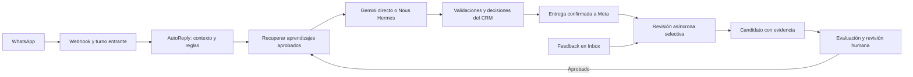

# Plan de desarrollo: memoria y mejora continua de Hermes

**Estado vigente (15/10/2026, America/Guayaquil).** F0: **APROBADA COMO LÍNEA BASE CON SEGUIMIENTO**. F0A: **CLOSED**. F1: **CLOSED** (`F1_CONVERSATION_FEEDBACK_VALIDATED_E2E`). F2: **CLOSED**, con `F2_PROVIDER_EVALUATION_GATE_CLOSED_WITH_OBSERVATION`; la variación del escenario E exige aprobación humana antes de activar aprendizaje. F3: **OPEN**; es el siguiente frente para analizar sus puertas pendientes. F4: **OPEN**. Backend servido reportado: `721f9756e658bc553ea0238b836fb236f8ae850b`; frontend servido reportado: `9793c84029efea18d3e17c6b8737dcc7793943f9`; **23 migraciones**, última `20261014120000_retention_recovery_policy`. Política de retención configurada, con backup periódico y restore-check desactivados (detalle en §9). `LEARNING_REVIEW_ENABLED=false`, `LEARNING_RETRIEVAL_ENABLED=false`, `LEARNING_SUMMARY_ENABLED=false`, `LEARNING_SHADOW_ENABLED=false`; allowlists vacías. Cerrar F2 no activa learning ni inicia F3. Los cortes anteriores conservan su valor histórico y quedan superados cuando difieren de este estado; esta sesión documental no inspeccionó VPS ni producción.

## 1. Resultado buscado y límites

Hermes debe aprovechar conversaciones anteriores para responder mejor a casos comerciales similares, reducir correcciones manuales y permitir medir si cada aprendizaje realmente ayuda. El circuito propuesto es:



Tres memorias cumplen funciones distintas:

| Memoria | Alcance | Fuente vigente o propuesta | Regla de uso |
| --- | --- | --- | --- |
| Contexto de una conversación | Un contacto y su conversación | `Message`, `ConversationState.summary`, `Lead.metadata.commercialProfile` | Recordar hechos del cliente; no convertir sus afirmaciones en políticas de Undercodeec. |
| Autoridad comercial | Todas las conversaciones pertinentes | `Product`, `PriceList`, políticas autorizadas en CRM | Única fuente de precios, alcance, impuestos, promociones, plazos confirmados y condiciones. |
| Experiencias aprobadas | Casos semejantes entre conversaciones | Nueva tabla `LearningItem` | Consejos de interacción y ejemplos anonimizados; subordinados a la autoridad comercial y a las guardas del backend. |

El aprendizaje **no modifica código, prompts base, precios ni políticas por sí mismo**. La confianza que estime un modelo sirve para priorizar revisión, no para publicar una regla. La propuesta de `prompt.md` de activar una regla por alcanzar 100 conversaciones o cierta confianza se deja para una etapa futura: volumen y puntuación no demuestran que la regla sea correcta ni aplicable a otro mercado. Tampoco se debe inferir que un cliente abandonó por una respuesta solo porque dejó de escribir.

No se necesita fine-tuning ni un servicio `intelligence/` independiente para la primera versión. Un módulo NestJS, PostgreSQL y una cola BullMQ encajan con el backend existente. Los embeddings se evalúan únicamente si una recuperación simple y medida resulta insuficiente.

## 2. Evidencia comprobada en el repositorio

1. `src/webhook/webhook.service.ts` persiste el inbound, aplica guardas y encola la respuesta. `src/auto-replies/auto-reply.service.ts` recupera hasta 20 mensajes, el estado y el perfil comercial; construye una instantánea autorizada, selecciona motor, valida, entrega y persiste. `src/auto-replies/inbound-turn.service.ts` coordina mensajes cercanos del cliente.
2. `src/conversation-engine/conversation-engine.service.ts` usa `HERMES_CONVERSATION_ENGINE=gemini_direct` por defecto. `nous_hermes` requiere configuración y una allowlist de UUID o `NOUS_HERMES_OPEN_INBOUND_TEST=true`. La instalación del agente VPS **no prueba** que atienda tráfico real.
3. `src/hermes/hermes.service.ts` contiene el prompt y la llamada del motor directo. `src/conversation-engine/nous-hermes.transport.ts` construye el prompt y contrato JSON del agente VPS; su petición lleva contexto por turno. `src/conversation-engine/agent-output.validator.ts` y `agent-proposal-policy.ts` validan su salida.
4. `src/hermes/commercial-policy.service.ts`, `commercial-authority.service.ts`, `commercial-claims.ts` y `src/conversation-guard/conversation-guard.service.ts` conservan reglas de respuesta, catálogo y seguridad fuera del modelo. `CommercialAuthorityService.snapshot()` obtiene ofertas vigentes de `Product`/`PriceList`; `commercialSnapshotKnowledge()` prepara el contexto comercial.
5. La ruta habitual pasa `commercialSnapshot` a `HermesService`. En `loadBusinessContext()`, una instantánea presente devuelve ese conocimiento inmediatamente; por ello, añadir un `KnowledgeDocument` o `SalesPlaybook` **no garantiza** que llegue a los turnos normales de WhatsApp. El aprendizaje necesita un campo propio en el contrato común.
6. `prisma/schema.prisma` ya modela `Conversation`, `Message`, `ConversationState`, `Lead`, `KnowledgeDocument` y `SalesPlaybook`. `ConversationState.summary` existe y se lee en `buildConversationContext()`, pero la búsqueda local no encontró un escritor regular de ese resumen. El perfil comercial se guarda en `Lead.metadata.commercialProfile` y su historial.
7. `AutomatedDelivery` ya registra preparación y confirmación de envíos. Los metadatos del primer mensaje contienen motor, modelo, `traceId`, diagnósticos y rechazos de propuestas. Se puede adjuntar allí la versión y los IDs de aprendizajes recuperados, contando como uso efectivo solo entregas confirmadas.
8. En el frontend hermano `D:/Documentos/undercodeec_nextjs`, `src/app/admin/crm/inbox/page.jsx` muestra el chat y las incidencias; `src/lib/hermes/api.js` centraliza peticiones, y `src/app/api/hermes/[...path]/route.ts` hace de proxy. La ausencia de feedback fue una observación del corte inicial: Fase 1 añadió controles de valoración al Inbox y el recorrido GOOD/BAD quedó validado E2E con asociación al mensaje, persistencia, reload, mensajes, deliveries, auth e idempotencia.
9. `test/fixtures/conversation-engine.baseline.json`, las pruebas comerciales y `src/scripts/benchmark-hermes.ts` fueron el punto de partida. El harness de F0 ya recorre 24 fixtures con ambos motores, guardas y entrega fake, sin enviar a Meta; `benchmark-hermes.ts` sigue midiendo otro recorrido.
10. `src/leads/leads.service.ts` permite `NEW → CONTACTED/QUALIFIED`, pero **no** el retroceso comercial normal `QUALIFIED → CONTACTED/NEW`. Pipeline y ficha ocultan ese movimiento normal. La corrección `QUALIFIED → CONTACTED` tiene API ADMIN separada, motivo, idempotencia, auditoría y conciliación del hito `LEAD_QUALIFIED`/job publicitario; la operación real fue reportada como completada por el operador.
11. El backend ofrece `POST /api/handoff` y `PUT /api/handoff/:id/take`; crear un handoff manual no exige rebajar la etapa del lead. La discrepancia inicial entre Inbox y `ConversationsService.reply()` motivó el takeover descrito en F0A: UI, propiedad del operador, guarda del servidor y supresión de entregas preparadas. El trigger compartido de `complaint` y el recorrido Inbox quedaron validados E2E el 12/10/2026. La auditoría del caso original se documenta en el cierre F0A posterior.

## 3. Decisiones de diseño

### 3.1 Separar revisión, memoria y ejecución

- La revisión se ejecuta **después** de una entrega confirmada o de una señal humana. No aumenta la latencia de WhatsApp. Feedback negativo e incidentes pueden revisarse enseguida; la muestra sin señal se revisa tras el siguiente mensaje, el cierre o una espera acotada para disponer de contexto posterior. En la primera versión se revisa una pequeña muestra configurable, no cada conversación; el silencio del cliente no cuenta como pérdida demostrada.
- Un revisor IA con prompt y esquema propios puede usar inicialmente la misma infraestructura de proveedor que el backend, mediante una cola aparte y presupuesto independiente. Su salida es un diagnóstico y, opcionalmente, un candidato. Nunca llama a Meta ni crea tareas comerciales.
- El candidato incluye situación, error observado, consejo breve, alcance (servicio/mercado), evidencia e incertidumbre. Se deduplica antes de aparecer en la bandeja de aprobación.
- Solo los elementos `ACTIVE` aprobados por un operador se recuperan para responder. Se limita a 2–3 elementos y a un presupuesto pequeño de caracteres/tokens. Las respuestas pasan otra vez por las validaciones existentes.
- La autoridad de `PriceList`, pagos, reserva de reuniones y handoff tiene prioridad sobre cualquier aprendizaje. Si una memoria parece contradecirla, se omite y se registra el conflicto.

### 3.2 No mezclar "caso de cliente" con "regla general"

Un mensaje como «necesito un sistema para 30 técnicos» puede aportar un ejemplo de cómo preguntar por procesos o integraciones. No autoriza la conclusión «todos los proyectos con 30 usuarios cuestan X». La revisión debe citar mensajes y correcciones, identificar contraejemplos y marcar como `NEEDS_REVIEW` cualquier afirmación comercial, legal, de pagos, privacidad o compromiso operativo.

La regla actual de responder un precio publicado cuando el cliente lo pide sigue vigente. El ejemplo de `prompt.md` «calificar antes de cotizar» se usa solo cuando **no existe un precio autorizado para el alcance solicitado**, y no para evadir una pregunta de precio que el CRM sí puede contestar.

## 4. Base de datos y flujo de memoria

### 4.1 Reutilizar lo existente

- `Message`: transcripción canónica del chat; el reviewer consulta por `conversationId` y `sourceMessageId`, sin copiar el texto completo a nuevas tablas.
- `ConversationState.summary`: resumen acotado de hechos de esa conversación. Añadir `summarySourceMessageId`, `summaryVersion` y `summaryUpdatedAt` para actualización incremental e idempotente. La primera fase puede conservar el resumen vacío; la escritura se activa tras comprobar utilidad con conversaciones largas.
- `Lead.metadata.commercialProfile`: datos comerciales del cliente con el historial actual. El resumidor no debe sobrescribir hechos corregidos por el cliente ni estados del CRM.
- `Product`/`PriceList`/política aprobada: autoridad global. `LearningItem` no contiene importes, condiciones de pago ni promesas de disponibilidad.

### 4.2 Tablas nuevas propuestas

Crear una migración Prisma aditiva, con claves foráneas e índices, sin alterar las filas históricas. Los nombres finales de enums y columnas se fijan al implementar, manteniendo este contrato funcional:

| Tabla | Campos esenciales | Relaciones e índices |
| --- | --- | --- |
| `ConversationFeedback` | `id`, `conversationId`, `messageId`, `userId`, `rating` (`GOOD`/`BAD`), `reasonCode`, `suggestedReply?`, `requestKey`, `createdAt` | FK a `Conversation`, `Message`, `User`; `requestKey` único para reintentos; índice `(conversationId, createdAt)`. Solo feedback sobre un outbound de Hermes de esa conversación. |
| `ConversationReview` | `id`, `reviewKey`, `conversationId`, `sourceMessageId`, `reviewerVersion`, `trigger`, `status`, `issueCode?`, `summary?`, `confidence?`, `providerModel?`, `createdAt` | `reviewKey` único; FK a `Conversation` y mensaje inbound; índice `(status, createdAt)`. Guardar diagnóstico breve, no conversación duplicada. |
| `LearningItem` | `id`, `fingerprint`, `version`, `status` (`PROPOSED`, `ACTIVE`, `REJECTED`, `RETIRED`), `kind`, `trigger`, `guidance`, `serviceCode?`, `market?`, `riskLevel`, `validUntil?`, `sourceReviewId?`, `approvedById?`, `approvedAt?`, `createdAt` | FK a review y aprobador; único `(fingerprint, version)`; índices por `status`, alcance y expiración. `guidance` es breve y no contiene PII. |
| `LearningEvidence` | `id`, `learningItemId`, `conversationId?`, `messageId?`, `feedbackId?`, `reviewId?`, `createdAt` | FK y unicidad por elemento/fuente. Referencia la evidencia canónica; no guarda transcripciones ni archivos. Si se elimina una fuente, revisar o retirar el elemento sin evidencia. |

`ConversationReview` y `LearningItem` no sustituyen `KnowledgeDocument`: documentos y playbooks siguen siendo material curado del CRM; `LearningItem` describe una pauta de interacción verificable. Un candidato se puede promover manualmente a documento o playbook si realmente representa conocimiento estable, con la revisión comercial normal.

La evaluación inicial usa fixtures anonimizados versionados en Git y resultados como artefactos de CI, sin tablas `Evaluation*` en producción. Si luego se necesita comparar experimentos desde el CRM, diseñar esas tablas a partir de la experiencia real de evaluación.

### 4.3 Recorrido de datos y controles de concurrencia

1. Meta entrega un `wamid` → `Message` y `InboundTurn` deduplican → `AutoReplyService` carga historia, perfil y `CommercialSnapshot`.
2. `LearningRetrievalService` busca solo `LearningItem.ACTIVE` que aplique al servicio y mercado, no esté vencido y no contradiga el snapshot. Devuelve consejos breves más `id`/`version`; ante error retorna lista vacía y emite una métrica.
3. `ConversationTurnInput.approvedContext` añade `approvedLearning` separado de `approvedKnowledge`. Ambos motores reciben el mismo campo. `HermesRequestDto` también lo acepta para `DirectGeminiEngine`.
4. El backend revisa la propuesta exactamente como hoy. Si la entrega se confirma, anota `learningItemIds` y versiones en metadatos del primer `AutomatedDelivery`, junto con motor, prompt y `traceId`. No contar como éxito las entregas `PREPARED`, `AMBIGUOUS` o suprimidas.
5. `ConversationReviewService` crea un job con clave idempotente basada en mensaje fuente, versión de rúbrica y motivo de revisión. El reviewer recibe una ventana acotada de mensajes pertinentes, feedback e información comercial de ese momento; rechaza PII y texto de instrucciones del cliente como autoridad.
6. Una revisión genera cero o un candidato. Candidatos equivalentes se agrupan por `fingerprint`; el contador de evidencias debe reflejar **conversaciones distintas**, no varios mensajes de una misma conversación. El operador aprueba, rechaza o retira con auditoría de usuario y fecha.
7. La actualización del resumen conversacional, si se habilita, usa `summarySourceMessageId` como marca de avance y una condición de versión para evitar que un job viejo pise una corrección posterior. El próximo turno lee el resumen y los mensajes recientes; el perfil del lead conserva los hechos estructurados.

## 5. Archivos a modificar y a crear

Rutas relativas a `hermes-backend/`, salvo el frontend indicado al final. La tabla conserva el mapa de implementación original; la sección 6 registra lo ya implementado, desplegado y aún pendiente.

| Archivo existente a modificar | Cambio previsto |
| --- | --- |
| `prisma/schema.prisma` y una nueva `prisma/migrations/<timestamp>_conversation_learning/migration.sql` | Tablas, FKs, índices y marcadores del resumen. Migración aditiva y reversible a nivel de comportamiento. |
| `src/auto-replies/auto-reply.service.ts` | Recuperación antes de `conversationEngine.respond()`, metadatos de memoria usada y disparo de revisión después de entrega confirmada; no tocar las guardas de Meta. |
| `src/auto-replies/auto-reply.module.ts` | Importar el nuevo módulo de aprendizaje; evitar dependencias circulares usando servicios exportados. |
| `src/conversation-engine/conversation-engine.types.ts` | Añadir `approvedLearning` al contrato común con ID, versión y consejo. |
| `src/conversation-engine/direct-gemini.engine.ts` | Pasar `approvedLearning` a `HermesRequestDto`. |
| `src/hermes/dto/hermes-request.dto.ts` y `src/hermes/hermes.service.ts` | Incluir sección de aprendizajes aprobados en contexto directo, con prioridad inferior a las reglas y al snapshot comercial. |
| `src/conversation-engine/nous-hermes.transport.ts` | Añadir aprendizajes al estado aprobado, con presupuesto y aviso explícito de que no son fuente comercial ni acciones ejecutadas. Mantener contrato privado y URL fijada. |
| `src/hermes/commercial-policy.service.ts` y `src/hermes/commercial-claims.ts` | Cambiar solo si las pruebas identifican una regla de precedencia faltante; jamás dejar que la memoria autorice precios. |
| `src/conversations/conversations.service.ts` y `src/conversations/conversations.controller.ts` | Exponer feedback del mensaje, resumen de calidad y vínculos a candidatos, o dejar estas rutas en `LearningController` si evita ampliar el controlador. |
| `src/handoff/handoff.service.ts`, `src/handoff/handoff.controller.ts` y `src/conversations/conversations.service.ts` | Fase 0A: utilizar el handoff manual existente desde Inbox, comprobar propiedad del operador y exigir en backend handoff tomado antes de enviar; coordinar la cancelación/supresión de respuestas automáticas pendientes. |
| `src/leads/leads.service.ts`, `src/leads/leads.controller.ts` y `src/advertising/advertising.service.ts` | Fase 0A: distinguir transición comercial normal de corrección de una calificación equivocada, auditar motivo y conciliar el hito publicitario según su estado real. |
| `src/app.module.ts` y `.env.example` | Registrar `LearningModule` y flags `LEARNING_REVIEW_ENABLED`, `LEARNING_RETRIEVAL_ENABLED`, límites de muestra, cuota y presupuesto; valores iniciales apagados. |
| `test/fixtures/conversation-engine.baseline.json` y `src/scripts/benchmark-hermes.ts` | Añadir casos anónimos y comparación controlada con/sin memoria. Evitar que el benchmark envíe WhatsApp. |
| `src/leads/leads.service.spec.ts`, `src/handoff/handoff.service.spec.ts`, `src/conversations/conversations.service.spec.ts`, `src/auto-replies/auto-reply.service.spec.ts` | Fase 0A: corrección auditada, toma de control, ventana de 24 horas y carrera con un turno automático en curso. |

| Archivo nuevo a crear | Responsabilidad |
| --- | --- |
| `src/learning/learning.module.ts` | Prisma, BullMQ, servicios y controladores del dominio de aprendizaje. |
| `src/learning/learning.constants.ts` y `learning.processor.ts` | Cola de revisión, idempotencia, concurrencia y reintentos acotados. |
| `src/learning/conversation-review.service.ts` | Elegir eventos para revisar, ensamblar contexto, guardar revisión y deduplicar candidatos. |
| `src/learning/review-model.service.ts` y `review-output.validator.ts` | Prompt/rúbrica del revisor, cliente del proveedor, JSON estricto, límites y redacción de datos. |
| `src/learning/learning-retrieval.service.ts` | Filtrar por estado/alcance/vigencia, ordenar relevancia, detectar conflictos y recortar el presupuesto. Iniciar con etiquetas/servicio y texto; medir antes de elegir vectores. |
| `src/learning/learning-approval.service.ts` | Transiciones `PROPOSED → ACTIVE/REJECTED → RETIRED`, versión, registro de aprobador y prohibición de activar elementos de alto riesgo sin revisión. |
| `src/learning/learning.controller.ts` y `dto/*.ts` | Feedback, lista de candidatos/evidencia y decisiones protegidas por JWT y roles; aprobación restringida a ADMIN. |
| `src/learning/conversation-summary.service.ts` | Fase posterior: resumen incremental de conversación, con hechos atribuidos y marca de avance. |
| `src/learning/*.spec.ts` y `test/conversation-learning.integration-spec.ts` | Casos significativos: deduplicación, reglas de prioridad, aislamiento entre clientes, carreras y persistencia en PostgreSQL/Redis desechables. |
| `docs/conversation-learning-operations.md` | Operación, métricas, apagado de flags, revisión de incidentes y criterio de restauración. |
| `src/leads/dto/correct-lead-stage.dto.ts` (condicional) | Si la auditoría confirma una calificación errónea, contrato separado para corrección por ADMIN con destino, motivo y clave de idempotencia; nunca ampliar indiscriminadamente `ALLOWED_STAGE_TRANSITIONS`. |

Frontend hermano, en `D:/Documentos/undercodeec_nextjs/`:

| Archivo | Cambio previsto |
| --- | --- |
| `src/app/admin/crm/inbox/page.jsx` y `src/app/admin/crm/crm.css` | Fase 0A: botón «Tomar control humano» cuando Hermes está activo, luego «Tomar atención» si el handoff queda pendiente, estado de ventana y caja de respuesta. Posteriormente, botones «útil»/«corregir» junto a mensajes de Hermes. |
| `src/lib/hermes/api.js` | Método para crear handoff manual desde Inbox; posteriormente, métodos de feedback, candidatos y aprobación. |
| `src/app/admin/crm/leads/page.jsx` y `src/app/admin/crm/leads/[id]/page.jsx` | Mostrar transiciones permitidas y una vía explícita de corrección auditada; la toma de control y el envío humano pertenecen al Inbox. |
| `src/app/admin/crm/aprendizajes/page.jsx` (nuevo) | Cola de candidatos con evidencia, versión, alcance, conflictos y aprobar/rechazar/retirar. |
| `src/app/admin/crm/_components/CrmShell.jsx` | Enlace de navegación para operadores autorizados. |
| `tests/hermes-learning-feedback.test.mjs` (nuevo) | Contrato de UI y errores de feedback/aprobación. |
| `tests/hermes-inbox-human-takeover.test.mjs` (nuevo) | Inicio de handoff desde chat activo, toma por operador y estados de caja/ventana; corregir o extender pruebas existentes de Pipeline para opciones de etapa. |

El proxy `src/app/api/hermes/[...path]/route.ts` ya enruta rutas generales; verificar sus reglas de método, timeout y caché antes de modificarlo. No suponer que necesita cambios.

## 6. Fases de trabajo y criterios de cierre

### Fase 0 — línea base y auditoría del entorno servido

Inventariar SHA/digest de backend, agente y frontend; confirmar motor efectivo, allowlist, migraciones, red, recursos y capacidad de PostgreSQL/Redis. Capturar una línea base de respuestas con escenarios sintéticos y casos reales **anonimizados/autorizados**. Registrar errores por tipo, tasa de handoff, p95 de latencia, costo por revisión y versión de prompt. No desplegar learning en esta fase.

**Salida:** acta fechada con evidencias sin secretos, riesgos de capacidad y decisión sobre dónde correr el reviewer. Si la VPS difiere del checkout, reconciliar arquitectura y revisar este plan antes de programar.

**Estado vigente: APROBADA COMO LÍNEA BASE CON SEGUIMIENTO.** Baseline, harness, offline, evaluación provider real, comparación de motores, preflight de capacidad, corrección de memoria y revisión humana están realizados. La aprobación reconoce esa línea base; no implica que se haya desplegado el harness, ejecutado carga representativa ni validado la operación periódica de backups. El defecto `complaint` se resolvió posteriormente en F0A, sin reabrir F0. Learning sigue **OFF**.

**Cronología F0 consolidada (evidencia VPS reportada por el operador; commits comprobables en Git local):**

| Hito | Resultado y límite |
| --- | --- |
| F0.1 Baseline original | Se observó `nous_hermes` en tráfico real, learning apagado, colas estables y backend/PostgreSQL/Redis sanos. Nous histórico: p50/p95 hasta preparación **15,458/21,782 s**; inbound→confirmado **24,133/31,574 s**. Son tramos distintos de la latencia del harness provider y no se comparan directamente. |
| F0.2 Deploy trazable | Backend productivo `d6125419dd50c534df1b2a2402b3982cf8f16e87`: build, pruebas dirigidas y `/api/docs` validados; PostgreSQL/Redis sanos, sin activar learning. Backups fuera del alcance inmediato por decisión del operador. |
| F0.3 Bloqueo inicial | La VPS no tenía evaluador fixture→backend final→engine→políticas/guardas→salida→delivery fake para ambos motores sin Meta. |
| F0.4 Harness inicial | `0eedd4af175f080f4924d828b07748803a111065`: datos sintéticos, Meta/WhatsApp inaccesibles, provider con opt-in, sin cambios al runtime productivo. 24 fixtures × 2 engines = 48 offline: **29 PASS, 19 FAIL_QUALITY, 0 FAIL_CRITICAL, 0 ERROR_INFRA, Meta 0**. |
| F0.5 Offline VPS | `PHASE0_VPS_OFFLINE_VALIDATED_READY_FOR_PROVIDER_AUTHORIZATION`: los mismos 24/48 y 29/19/0/0; Meta 0, WhatsApp 0, provider calls 0; producción intacta. |
| F0.6 Capacidad | `BLOCKED_CAPACITY`: ~8,32 GiB libres / 85 % antes de `npm ci`, ~7,70 GiB / 86 % después. Se abortó antes de Nous, Gemini y Meta. |
| F0.7 Espacio | Limpieza segura de cache npm y worktrees temporales antiguos recuperó ~1,91 GB; no tocó releases, backups, imágenes/volúmenes productivos ni containerd productivo. Preflight ~10,08 GiB / 82 %; tras `npm ci`, ~9,39 GiB / 83 %. |
| F0.8 Primer smoke real | `ABORTED_SAFETY_GUARD`: Nous terminó con `NODE_HEAP_EXHAUSTED` en `HARNESS_PROCESS`, exit 134, V8 ~391 MB frente a límite efectivo Node 20 ~396 MiB bajo 768 MiB. Sin OOM del kernel ni `oom_kill`; Nous sano y ~1,5 GiB RAM host disponible. `REQUIRES_LOCAL_HARNESS_MEMORY_FIX`. |
| F0.9 Memoria local | `8b71bc00a70090acfd2bf59eebc78b6d3e129bf5` reemplazó `ts-node` por JS compilado; concurrencia provider 1, casos/engines secuenciales, reporte incremental, clientes provider construidos al invocarse y fake Meta conservado. Smoke local: heap/RSS **532/680 MB → ~40/112 MB**; recorrido offline **541/686 MB → ~41/118 MB**. Pasaron 18 pruebas, build, lint, Prisma y 24/48 offline con 29/19/0/0 y Meta 0. `PHASE0_HARNESS_MEMORY_OPTIMIZED_READY_FOR_VPS`. |
| F0.10 Provider real VPS | Con Node 20 y harness `8b71bc0`, ambos smokes y 24 Nous + 24 Gemini terminaron secuencialmente sin OOM, Meta ni WhatsApp; producción intacta. `PHASE0_PROVIDER_EVALUATION_READY_FOR_HUMAN_REVIEW`. |

| Motor en F0.10 | PASS | FAIL_QUALITY | FAIL_CRITICAL | ERROR_INFRA | Latencia p50/p95 del harness | Tokens reportados |
| --- | ---: | ---: | ---: | ---: | ---: | ---: |
| Nous Hermes | 18 | 5 | 1 | 0 | ~7,27 / ~26,12 s | 40.794 |
| Gemini Direct | 19 | 4 | 1 | 0 | ~2,68 / ~6,73 s | 60.847 |

Costo provider: **N/D**; no estimarlo a partir de tokens. Las latencias de F0.10 miden el harness y no el tramo histórico inbound→confirmado. Se revisaron humanamente 12 pares representativos: Gemini tuvo una pequeña ventaja automática, menor latencia y mayor consistencia estructural; Nous aportó más contexto comercial y personalización en varios casos. **No cambiar automáticamente el motor productivo Nous** con este corpus; la elección requiere evaluación continua separada.

**Hallazgos de la revisión humana:** `complaint` dio `FAIL_CRITICAL / human_handoff` en ambos motores porque el flujo no registró la derivación esperada; fue un defecto compartido de trigger/handoff transferido a F0A y **resuelto el 12/10/2026** según la actualización vigente más abajo. El recorrido esperado era reclamo → detectar escalamiento → crear/reutilizar handoff → acknowledgement → detener automatización normal. Learning no lo corrige. En `store-customer-payment`, ambos fallaron `no_project_payment_confusion`, pero el cliente preguntaba por pagos de sus compradores: revisar primero el control del evaluador por posible falso positivo. En `conversation-a-private-context`, ambos fallaron `use_own_context`: aprovechar el presupuesto del cliente (USD 700) sin convertirlo en tarifa autorizada. En `timeline-without-source`, Gemini respondió mejor según revisión humana y Nous falló un control de quote/human; queda como señal para futuras evaluaciones, no como segundo bloqueo crítico. Los textos completos quedan fuera de este plan.

### Fase 0A — caso real, corrección de etapa y atención humana en Inbox

**Estado vigente: CERRADA (12/10/2026).** `complaint → human_handoff` y toma humana desde Inbox están validados E2E; las regresiones dirigidas cubren `human-request`, queja equivalente, handoff existente, `PENDING`/`IN_PROGRESS`, concurrencia, supresión `HANDOFF_ACTIVE` y reply con/sin ownership. La auditoría del caso real, la decisión comercial y la corrección ADMIN con conciliación publicitaria fueron reportadas por el operador; las pruebas anónimas derivadas quedaron documentadas en el corte del 12/10 al final de la sección 9. Los párrafos fechados del 08/10 conservan sus pendientes de aquel momento.

Este trabajo se definió **antes** del feedback general, aunque F1 avanzó por decisión posterior del operador. El caso relatado: una clienta entró como lead nuevo, fue movida manualmente a `QUALIFIED`, la UI luego ofreció volver a `CONTACTED`/`NEW` y el backend respondió «Transición no permitida: QUALIFIED → CONTACTED». En el corte original, el Inbox no ofrecía iniciar atención humana mientras Hermes controlaba la conversación; el trabajo posterior agregó esa acción, validada E2E el 12/10/2026 con un fixture autorizado. La conversación original, según la observación del operador, muestra interés en seguir hablando, pero Hermes repite ideas, no concreta seguimiento ni explora una intención útil. **Esto era una hipótesis de calidad pendiente de auditoría turno por turno en el corte inicial**, no una conclusión automática sobre la clienta. El contenido anterior de `ProyectMD/prompt.md` explicaba el learning loop; en el corte del 13/10 contenía una instrucción posterior y no una transcripción del caso.

1. **Identificar y preservar la evidencia.** Con acceso autorizado, registrar internamente `leadId`, `conversationId`, IDs de mensajes, `wamid` enmascarado, tiempos y zona, etapa/historial de `AuditLog`, motor y `promptVersion`, `ConversationState`, perfil comercial, políticas/snapshot, tareas, handoff, `AutomatedDelivery` y ventana de 24 horas. Mantener texto original solo en el CRM; trabajar en Git con una versión anonimizada aprobada. No cambiar etapa ni enviar mensajes durante la inspección.
2. **Separar los dos estados.** `Lead.stage=QUALIFIED` expresa calificación comercial; `Conversation.status=ACTIVE/HANDED_OFF` expresa quién atiende el chat. Se debe poder tomar control humano **sin** devolver el lead a `CONTACTED`. Comprobar en producción si la conversación está activa, cerrada o ya tiene handoff; si está cerrada, usar el recorrido de reapertura existente antes de iniciar uno nuevo.
3. **Habilitar «Tomar control humano» en Inbox.** Sobre conversación activa sin handoff, el operador inicia `POST /api/handoff` con razón `CUSTOM` o `INFO_ERROR` y detalle interno; el backend crea/reutiliza el handoff idempotentemente y marca `HANDED_OFF`. Después, `PUT /api/handoff/:id/take` lo asigna al operador. Refrescar la vista y permitir texto solo si el handoff está tomado y la ventana de servicio sigue abierta. No crear un botón de envío desde Pipeline; este puede enlazar al Inbox. Mostrar errores recuperables si el estado cambia durante la operación.
4. **Cerrar la regla en el servidor.** Antes de llamar a Meta, `POST /api/conversations/:id/reply` debe verificar handoff abierto y asignación del operador, además de la ventana de 24 horas; revalidar el estado frente a carreras con el worker y mantener auditoría. Comprobar la guarda final de `AutomatedDelivery`: un job de Hermes ya preparado debe suprimirse al pasar a control humano, salvo un despacho a Meta ya aceptado que requiera conciliación. Evitar respuesta humana y bot simultáneas; no declarar enviado si Meta no devolvió `wamid`.
5. **Corregir la etapa por la vía adecuada.** La transición hacia atrás está excluida intencionalmente de `ALLOWED_STAGE_TRANSITIONS`; la UI no debe presentarla como un movimiento normal. Si `QUALIFIED` fue un clic equivocado, diseñar una operación **ADMIN de corrección**, con motivo, `AuditLog`, idempotencia y comprobación del `LEAD_QUALIFIED`/`AdvertisingSyncJob` existente. Si el hito sigue pendiente, evaluar su anulación controlada antes de sincronizar; si está enviado/aceptado o ambiguo, no borrarlo ni fingir que el rollback comercial lo revierte externamente: registrar la rectificación y definir conciliación específica. Si la calificación era válida, conservar `QUALIFIED` y resolver únicamente el control humano. Probar ambos caminos sin editar filas a mano.
6. **Auditar la conversación.** Construir una cronología cliente → propuesta del motor → sustituciones/políticas → mensajes realmente confirmados → reacción posterior. Comparar lo que el cliente preguntó con lo que Hermes respondió; contar repeticiones, preguntas ya contestadas, cambios de tema ignorados, seguimiento prometido sin tarea y oportunidades de una pregunta concreta o propuesta de siguiente paso. Revisar si el efecto provino del modelo, `CommercialPolicyService`, límites de contexto o reglas del worker. No atribuir una respuesta extraña al agente VPS sin verificar `conversationEngine` del mensaje.
7. **Aprender de forma controlada.** Elaborar 2–4 escenarios anónimos derivados del caso: clienta que quiere continuar, cambio de necesidad, petición de humano y corrección de clasificación. Para cada uno definir respuesta aceptable, siguiente paso permitido y antiobjetivos (repetición, presión por presupuesto, propuesta comercial inventada). Añadirlos al corpus de evaluación; el caso completo no pasa a memoria global. Solo una pauta general con evidencia y aprobación podrá convertirse luego en `LearningItem`.

**Criterio de cierre F0A actualizado (12/10/2026).** **Cerrados:** `complaint → human_handoff` determinístico y E2E; takeover, ownership, respuesta humana y silencio automático en `IN_PROGRESS`; UI sin retrocesos comerciales normales inválidos; auditoría del caso original y revisión turno por turno según evidencia del operador; decisión humana de que `NEW → QUALIFIED` fue una prueba; corrección ADMIN `QUALIFIED → CONTACTED` por API, idempotencia y cancelación del job publicitario sin efecto externo; escenarios anónimos y controles offline de calidad. `QUALIFIED → CONTACTED/NEW` sigue sin ser una transición comercial normal. Los límites de calidad generativa y de ventana de contexto se transfieren a evaluación posterior, sin activar learning.

**Avance local del bloque «Tomar control humano» (08/10/2026).** Se añadió en Inbox la acción para conversaciones `ACTIVE` sin handoff, con motivo `CUSTOM`/`INFO_ERROR` y detalle interno obligatorio; llama a `POST /api/handoff`, refresca la conversación y permite tomar el handoff pendiente con el operador autenticado. La caja de respuesta se habilita solo para ese operador cuando el handoff está `IN_PROGRESS` y la ventana está abierta. El backend vuelve a comprobar estado, propietario y ventana antes de enviar a Meta, bajo el mismo bloqueo por conversación que usa el lote de entregas automáticas; el ledger suprime entregas preparadas al detectar el handoff. Se conservan la etapa comercial y la auditoría existentes. Compilaciones de backend y frontend, ESLint dirigido y 37 pruebas dirigidas pasaron en el checkout local. Queda pendiente comprobar este recorrido en el entorno servido y con el caso real autorizado; los demás puntos de Fase 0A no están cerrados.

**Actualización del bloque «Tomar control humano» (12/10/2026): VALIDADO E2E.** La release limpia F0A, su despliegue, smoke y un fixture E2E autorizado/controlado por el operador confirmaron complaint, toma de atención, owner autenticado, respuesta humana confirmada por Meta, auditoría y silencio de Hermes durante `IN_PROGRESS`. Esta validación supera el pendiente del corte del 08/10; el fixture de prueba es distinto del caso real original, cuya auditoría comercial se completó después según el cierre F0A.

**Cronología de clean release y despliegue F0A (12/10/2026; VPS según evidencia reportada por el operador).** La primera rama `origin/f0a-complaint-human-handoff` con commit funcional `460542448177f2fcc65a0c696a50e92461f86a84` fue bloqueada correctamente por `BLOCKED_F0A_RELEASE_ANCESTRY`: arrastraba `0eedd4af175f080f4924d828b07748803a111065` y `8b71bc00a70090acfd2bf59eebc78b6d3e129bf5`, commits del harness Phase 0; el commit F0A también modificaba un spec creado por esos ancestros. Se preservó esa rama sin desplegarla. Desde la base productiva anterior `d6125419dd50c534df1b2a2402b3982cf8f16e87` se publicó `origin/f0a-complaint-human-handoff-release` en `093d6e18f9f345394a59c9a248f21ea07e5639ca`: exactamente **un commit** y **cero ancestros Phase 0 intermedios**. El bloqueo fue una guarda de release correcta, no un fallo funcional.

La clean release local dio `F0A_CLEAN_RELEASE_READY_FOR_VPS`, con migraciones **0** y exactamente seis archivos: `src/auto-replies/auto-reply.service.ts`, `src/auto-replies/auto-reply.service.spec.ts`, `src/hermes/commercial-policy.service.ts`, `src/hermes/commercial-policy.service.spec.ts`, `src/handoff/handoff.service.spec.ts` y `src/automated-deliveries/automated-delivery.service.spec.ts`. Quedaron fuera harness, fixtures/scripts de evaluación, documentación experimental, Calendar, learning, Google Ads, cambios de package/lockfile y artefactos temporales. Pasaron pruebas de complaint/queja equivalente, human-request, duplicados/concurrencia, `PENDING`, `IN_PROGRESS`, `HANDOFF_ACTIVE`, ownership, ambos engines sin invocación, build, lint dirigido y Prisma validate. En predeploy VPS pasaron **5 suites / 258 tests**, build, lint dirigido y Prisma; en postdeploy pasaron **4 suites / 13 casos sintéticos**, con **113 casos no seleccionados/skipped** en esa corrida dirigida. Los casos incluyeron complaint, human-request, sentimiento negativo trivial, reutilización, concurrencia, idempotencia, ownership y supresión de delivery.

**Producción reportada en ese corte del 12/10 (histórica):** `F0A_DEPLOYED_READY_FOR_AUTHORIZED_E2E`; el backend servido entonces era `093d6e18f9f345394a59c9a248f21ea07e5639ca`, comprobado por etiqueta OCI. Frontend y `.env` no cambiaron; learning permaneció OFF. Se conservaron imagen anterior para rollback, imagen nueva, manifest y acta. La evidencia VPS detallada se reportó en `/var/www/hermes/docs/acta-validacion-vps-f0a-complaint-human-handoff-2026-10-12.md`; este plan no reproduce esa acta ni presupone una copia local. El flujo corregido detecta complaint explícito en `CommercialPolicy`, llama a `HandoffService.create(COMPLAINT)` antes del engine, pone la conversación en `HANDED_OFF`, confirma un `SYSTEM_NOTICE` seguro y retorna. Nous y Gemini registraron **0 llamadas** para ese inbound; el cambio no depende del motor ni de learning. El lock transaccional/advisory por conversación permite reutilizar `PENDING` e `IN_PROGRESS`, preservar el owner y evitar duplicados ante dos complaints concurrentes.

**E2E real autorizado desde Inbox: `F0A_COMPLAINT_HUMAN_HANDOFF_VALIDATED_E2E`.** En una conversación de prueba controlada se envió un complaint real: quedó **un** handoff `COMPLAINT`, conversación `HANDED_OFF`, handoff `PENDING` y `SYSTEM_NOTICE` confirmado; hubo **0** `HERMES_REPLY`, **0** jobs Nous asociados, **0** llamadas Gemini y ninguna respuesta automática posterior. El operador autenticado pulsó «Tomar atención»: `PENDING → IN_PROGRESS`, con ownership del operador real. Su respuesta desde Inbox fue confirmada por Meta, atribuida a ese operador y auditada como `HUMAN_MESSAGE_SENT`. Durante la toma entraron **dos** mensajes adicionales, uno por WhatsApp real del número de prueba; permanecieron en la misma conversación con handoff `IN_PROGRESS` y owner conservado. Hermes no preparó ni envió respuestas, y ninguno de los dos engines respondió. El fixture se dejó deliberadamente en `IN_PROGRESS` bajo control humano para preservar auditoría; no se registran aquí identificadores, teléfono ni contenido sensible.

**Límite de la evidencia de delivery.** Una entrega comercial `PREPARED` seguida de handoff activo quedó `SUPPRESSED` con `HANDOFF_ACTIVE` y **0 envíos** Meta mock en la prueba sintética. En el fixture E2E real no había una entrega comercial `PREPARED` previa; para esa condición concreta prevalece la evidencia sintética. La validación E2E del takeover no autoriza `LEARNING_REVIEW_ENABLED`, `LEARNING_RETRIEVAL_ENABLED`, `LEARNING_SUMMARY_ENABLED` ni `LEARNING_SHADOW_ENABLED`: todos siguen **OFF**. La decisión de motor permanece separada; F0 mostró pequeña ventaja automática y mayor velocidad de Gemini, y más contexto de Nous en algunos casos. Los **6 hallazgos npm audit** reportados durante el build F0A son deuda técnica para triage separado; no se cambió el lockfile y no bloquean este subobjetivo.

**Continuación local de Fase 0A (08/10/2026).** Pipeline (arrastre y selector móvil) y ficha del lead ofrecen únicamente movimientos comerciales normales que `LeadsService` permite. Se ocultan los retrocesos desde `QUALIFIED`, las etapas de pago que requieren el flujo de Inbox/WhatsApp y `WON` cuando faltan datos contractuales o no se ha comprobado el estado de la transferencia. La guarda del cliente evita una solicitud accidental, mientras que la API conserva la decisión final. Pasaron dos pruebas dirigidas de la matriz de transiciones, ESLint dirigido y `pnpm build`; falta validar la interfaz servida. Esta mejora **no** corrige por sí sola el lead concreto: aún se necesita su `leadId`/`conversationId` bajo acceso autorizado, auditar `LEAD_QUALIFIED` y `AdvertisingSyncJob`, decidir si la calificación fue errónea y, solo entonces, ejecutar o diseñar la corrección ADMIN conciliada. También siguen pendientes la revisión turno a turno y los escenarios anónimos derivados del caso. No marcar Fase 0A como cerrada ni empezar Fase 1 sobre una validación E2E supuesta.

**Validación VPS reportada de Fase 0A (08/10/2026, informe recibido 12:59 America/Guayaquil).** La release web `9d63e539f571aee71e4c7c7301be2706bc0f84a2` se activó con `BUILD_ID=yKnjnnSlDMx1dZmFONRHL`, conservando `d4107c38f91d…` como `previous`. Pasaron las dos pruebas dirigidas, ESLint, build, salud PM2/Nginx y comprobación HTTPS/asset 200. La inspección de UI/artefacto confirma que `QUALIFIED` ya no ofrece `CONTACTED` ni `NEW`, sí ofrece `PROPOSAL` y deriva pagos al Inbox. No hubo lead ni sesión de prueba autorizados; no se verificó el recorrido real de toma, respuesta humana y ventana de 24 horas en esta ejecución. Siguen faltando `leadId`/`conversationId` y autorización para auditar el caso, dictaminar la calificación, conciliar `LEAD_QUALIFIED`/`AdvertisingSyncJob`, revisar la conversación turno por turno y crear escenarios anónimos. **Fase 0A permanece abierta.**

**Actualización intermedia del 12/10/2026:** la falta de fixture/operador de prueba autorizado del 08/10 fue superada con el E2E controlado descrito arriba. Los identificadores y la auditoría del **caso real original** todavía faltaban en ese momento; se completaron posteriormente según el cierre F0A.

**Comprobación manual comunicada por el operador (08/10/2026).** En la release servida, los avances permitidos funcionan, los retrocesos quedan bloqueados visualmente y no se observaron regresiones visuales. La revisión local de `src/app/admin/crm/leads/[id]/page.jsx` confirmó que «Revisar transferencia en Inbox» y «Abrir comprobante en Inbox» enlazan a `/admin/crm/inbox?conversationId=…`; aún falta comprobar esos clics en la release servida. También falta mover un lead **de prueba** por una transición válida, recargar Pipeline/ficha y confirmar que la etapa persiste. Esta evidencia acota el bloque de UI de etapas, pero no cierra Fase 0A ni sustituye la auditoría del caso real y el recorrido de atención humana.

**Paquete de continuación para VPS (08/10/2026).** `../../logs.log` contiene el resultado reportado de la liberación limitada de capacidad y un prompt único de cierre ordenado de Fases 0, 0A, 1, 2, 3 y 4. Los prompts históricos de validación Fase 0A/1, auditoría y preparación deben regenerarse desde este plan si vuelven a necesitarse. El resultado no sustituye un acta: al recibir evidencia verificable del harness, añadir aquí sus observaciones y pendientes. Las instrucciones de ejecución exigen fixtures autorizados, prohíben secretos/tráfico real y mantienen los flags `LEARNING_*` apagados.

**Secuencia de aquel corte (13/10/2026; superada el 15/10):** F0 ✅ baseline aprobada; F0A ✅ cerrada; F1 y F2 aún ⏳ entonces. La validación E2E posterior cerró F1; control de canary, segundo canary, retención/recuperación y evaluación del provider cerraron F2. La secuencia vigente es F0 ✅, F0A ✅, F1 ✅, F2 ✅, F3 ⏳, F4 ⏳, con los cuatro flags learning OFF.

### Fase 1 — feedback útil sin IA adicional

Migración de `ConversationFeedback`, endpoint JWT, botones en Inbox e identificadores exactos del mensaje evaluado. Permitir feedback positivo/negativo y corrección opcional. Añadir vistas simples de volumen y motivos. Es la fuente de ejemplos de calidad para no depender únicamente del juicio de otro modelo.

**Estado vigente (15/10/2026): CLOSED.** `F1_CONVERSATION_FEEDBACK_VALIDATED_E2E`: GOOD/BAD desde Inbox se asociaron al mensaje correcto y se validaron persistencia, reload, messages, deliveries, auth e idempotencia. Los párrafos del 08/10 siguientes describen un corte previo y sus pendientes ya superados.

**Cierre:** un operador marca una respuesta y la ve asociada al mensaje correcto; reintentar la misma solicitud no duplica el feedback; otro rol no puede aprobar; ningún feedback modifica una respuesta enviada.

**Decisión de continuación (08/10/2026).** Por instrucción del operador se avanza con Fase 1 mientras la Fase 0A queda pendiente de comprobaciones manuales de leads. Esta decisión no cierra Fase 0 ni Fase 0A y no habilita el reviewer, recuperación de memorias o resumen de las fases posteriores.

**Implementación local de Fase 1.** La migración `20261008180000_conversation_feedback` agrega `ConversationFeedback` con FK a conversación, mensaje y operador, `requestKey` único, unicidad por mensaje/operador y borrado en cascada con las fuentes. `POST /api/feedback` recibe `conversationId`, `messageId`, `rating`, `reasonCode`/`suggestedReply` opcionales y `requestKey`; `GET /api/feedback/conversation/:conversationId` devuelve registros y totales por valoración/motivo. Ambos exigen JWT y rol ADMIN o SALES_AGENT; no existe ruta de aprobación en esta fase. La API acepta solo un outbound `HERMES` de la conversación con `wamid`, exige motivo para `BAD`, permite corrección de texto de hasta 2000 caracteres y devuelve el mismo registro ante reintento idéntico. Una clave reutilizada para otro contenido o una segunda valoración del mismo operador se rechaza; el mensaje original queda intacto. En Inbox, los botones «Útil»/«Corregir» aparecen junto al mensaje exacto, muestran la valoración propia y un resumen de volumen y motivos de la conversación. La sugerencia queda en el CRM y no se envía a Meta. Pasaron `prisma validate`, build NestJS, 9 pruebas dirigidas, ESLint dirigido y build Next.js. Rollback conductual: volver a las releases anteriores de API/web deshabilita las rutas y controles; la tabla aditiva puede permanecer aplicada hasta completar la retención de datos. La migración y el recorrido de operador en VPS siguen pendientes de validación antes de declarar cerrada Fase 1.

**Despliegue técnico de Fase 1 reportado desde VPS (08/10/2026, 19:23 UTC).** El operador aportó un acta: backend `4118a3a`, frontend `849fe44`, migración `20261008180000_conversation_feedback` aplicada sin pendientes, `/api/docs` 200, app `running` con 0 reinicios y CRM HTTPS 200 con asset nuevo. El backup PostgreSQL previo al despliegue tiene checksum verificado y `pg_restore` puede leerlo; no se hizo restauración aislada. Los checkouts sucios originales quedaron preservados. No hubo prueba funcional de feedback ni UI con fixture, JWT y operador sintéticos autorizados. Por tanto la Fase 1 está **desplegada y validada técnicamente**, pero su criterio de cierre funcional sigue pendiente; Fases 0/0A no se cierran por este despliegue.

### Fase 2 — reviewer asíncrono y candidatos

Crear cola separada, contrato de salida estricto, `ConversationReview` y `LearningItem`/evidencias. Arrancar solo con feedback negativo e incidentes; después muestrear algunos turnos sin señal humana. Usar cuota diaria y pausa automática si suben errores o costo. Generar candidato únicamente si existe evidencia concreta y un problema generalizable; guardar `NO_LEARNING` cuando no lo hay. Revisar sesgos: mercado, servicio, secuencia de mensajes, respuestas humanas y corrección posterior del cliente.

**Estado vigente (15/10/2026): CLOSED.** Reviewer/candidato, canary, revisión humana, retención/recuperación y evaluación real del provider completaron sus puertas de F2. `F2_PROVIDER_EVALUATION_GATE = CLOSED`, con observación conocida en E. Reviewer productivo y los otros tres flags learning permanecen OFF; allowlists vacías. Las actas de bloqueo del 08–13/10 siguientes describen estados históricos superados, no pendientes actuales de F2.

**Cierre:** idempotencia tras reinicio y reintento, candidato sin PII, ninguna llamada a Meta, fallos del reviewer aislados del chat, deduplicación y explicación breve de evidencia/contraejemplos en el CRM.

**Despliegue técnico de Fase 2 reportado desde VPS (08/10/2026, 21:53 UTC).** Los SHAs servidos son backend `b8b1ad3447f3cb4749f0981ede2b950b52ffa7cb` y frontend `4397cb61679e4c3ad265911a5046696ea5b3ca89`. Tras restaurar dependencias de desarrollo en el worktree limpio, pasaron 14/14 pruebas dirigidas; Prisma, builds y Compose también fueron correctos. Se verificó el backup `postgres-phase2-20261008T215307Z.dump` con checksum y `pg_restore -l` (298 entradas), se aplicó únicamente `20261008200000_conversation_learning_review` y Prisma no dejó pendientes. La app quedó `running` sin reinicios; `/api/docs` respondió 200, la ruta de candidatos devolvió 401 sin JWT y el CRM entregó el asset nuevo. El release web anterior y el rollback de backend quedaron registrados. Los flags permanecen ausentes/apagados y la cola de learning quedó en cero, sin llamadas a IA/Meta ni trabajos procesados. Esta evidencia valida el despliegue técnico, no el recorrido del reviewer.

#### Pendientes identificados tras la validación VPS (corte histórico del 08–13/10; resueltos para F2)

**Acta recibida del VPS el 08/10/2026.** En el worktree backend `b8b1ad3` se confirmaron Jest y `ts-jest` locales; pasaron 2 suites y 14 pruebas. `prisma validate` pasó con una URL sintética de loopback, sin conexión. No se ejecutó E2E: no existe spec de integración learning, harness ni doble local de proveedor; el Compose disponible usa nombres, volúmenes y red productivos y exige un entorno externo. No se crearon recursos de prueba. La lectura productiva mostró los tres flags `LEARNING_*_ENABLED` ausentes y la cola learning vacía. La VPS no pudo verificar el artefacto frontend desde un worktree independiente en esa sesión. No hubo llamadas de proveedor, Meta ni ejecución de reviewer atribuibles a esa validación. Esta acta no equivale a pruebas de PostgreSQL/Redis reales ni a resultados de calidad.

**Harness local preparado (08/10/2026).** Se añadió `docker-compose.learning-test.yml` con proyecto `hermes-learning-test`, PostgreSQL en `127.0.0.1:55432` y Redis en `127.0.0.1:56379`, volúmenes exclusivos y sin red, secretos ni destinos de producción. `npm run learning:harness:up`, `npm run test:learning:integration` y `npm run learning:harness:down` levantan, migran, prueban y eliminan el entorno. El runner rechaza cualquier URL que no sea el PostgreSQL/Redis locales esperados. La integración usa un servidor HTTP local como doble del reviewer y cubre `NO_LEARNING`, candidato `PROPOSED`, redacción y rechazo de PII sintética, JSON/referencias inválidas, idempotencia/deduplicación de evidencia, reintento, reencolado tras reinicio, cuota y pausa tras tres fallos. Falta ejecutar este harness en VPS y anexar su acta antes de considerar cerrado el punto 1.

**Validación local del harness (08/10/2026).** En el entorno aislado se aplicaron las 21 migraciones, incluida `20261008200000_conversation_learning_review`, y pasaron 8/8 pruebas de `conversation-learning.integration-spec.ts`. Las cuatro salidas inválidas registraron `FAILED` y relanzaron el error esperado para el reintento; no hubo tráfico a Meta, Nous ni a un proveedor externo. El contenedor local se elimina al terminar la validación. El punto 1 queda implementado y validado localmente; su ejecución independiente en VPS (punto 2) permanece pendiente y no autoriza activar flags.

**Intento de validación VPS del harness (08/10/2026, resultado recibido 20:08 America/Guayaquil).** El preflight se detuvo correctamente con `BLOCKED_CAPACITY`: la raíz tenía 2,1 GiB libres y 97 % de uso, por debajo de los 8 GiB y por encima del 85 % permitidos. Había 1,8 GiB de memoria disponible; `postgres:16-alpine` y `redis:7-alpine` estaban presentes; los puertos 55432/56379 estaban libres; y no existían recursos `hermes-learning-test`. No se localizó checkout, hizo fetch, verificó SHA, creó worktree, instaló dependencias, aplicó migraciones ni ejecutó pruebas. No hubo cambios a flags/colas, Meta, Nous, proveedor, `hermes-app`, PM2, Nginx, Compose, bases, Redis, `.env` ni configuración de producción. El harness sigue pendiente de ejecución VPS **después** de liberar capacidad mediante una operación autorizada; no habilitar learning por este acta.

**Acta VPS de recuperación de capacidad (08/10/2026, resultado recibido después del bloqueo).** La operación autorizada elevó el espacio libre de la raíz de **2,1 GiB / 97 %** a **9,5 GiB / 83 %**, cumpliendo el preflight mínimo de 8 GiB libres y uso no mayor de 85 %. `docker builder prune --all --force` dejó la caché BuildKit de 8,531 GiB contabilizados en 0 B y el cambio real observado por `df` fue de ~6,4 GiB; `journalctl --vacuum-size=300M` redujo el journal de 1,2 GiB a 295 MiB y reportó 963,9 MiB recuperados. La salvaguarda bloqueó correctamente la eliminación de temporales, por lo que los tres temporales y la caché Jest reciente quedaron intactos. Se reportaron 7 contenedores en ejecución, ninguno no saludable, daemon Docker activo, puertos de prueba libres, ~1,84 GiB de memoria disponible y cero recursos `hermes-learning-test`; no hubo builds/despliegues en curso ni cambios de flags, colas, servicios, releases, imágenes, volúmenes, bases, secretos o configuración productiva, y no se inició tráfico externo.

**Estado de ese intento del 08/10:** el harness no se ejecutó porque la VPS no localizó `docker-compose.learning-test.yml` ni sus scripts en los worktrees inspeccionados. No se debía improvisar otro Compose. `BLOCKED_CAPACITY` se había resuelto y quedaba `HARNESS_ARTIFACT_NOT_AVAILABLE`; la actualización vigente de Fase 2 al inicio de esta sección incorpora la validación posterior.

**Acta VPS de seguimiento de fases abiertas (informe recibido el 09/10/2026).** No se cerró ninguna fase ni se modificó producción. Antes y después de la sesión la raíz permaneció con 9,5 GiB libres y 83 % de uso; Docker reportó 42 imágenes, 15 contenedores y 32 volúmenes. Los flags `LEARNING_*_ENABLED` consultados seguían ausentes; la cola de revisiones estaba vacía y la de respuestas automáticas no tenía trabajos pendientes. La comprobación final no encontró contenedores, redes, volúmenes ni puertos de `hermes-learning-test`, y no hubo llamadas a Meta ni a proveedores de IA.

- **Fase 0:** se obtuvo una línea base parcial: 21 migraciones aplicadas, tres entregas confirmadas por `nous_hermes` y una con motor desconocido en la ventana observada, más un dump PostgreSQL reciente con checksum válido. No se hizo restauración aislada ni carga; quedan `BLOCKED_BACKUP_RESTORE_ENVIRONMENT`, latencia/costo y capacidad bajo carga.
- **Fases 0A y 1:** no se ejecutaron, porque no se entregaron `leadId`/`conversationId` de prueba, outbound de prueba con `wamid`, ni operador/JWT autorizados. Quedan `BLOCKED_TEST_FIXTURE_AND_OPERATOR`; no se tocó ningún lead, conversación, handoff, entrega o evento publicitario real.
- **Fase 2 en ese corte:** una búsqueda de sólo lectura en 14 checkouts/worktrees Hermes no encontró `docker-compose.learning-test.yml` ni los tres scripts del harness. Entonces persistía `HARNESS_ARTIFACT_NOT_AVAILABLE`: se debía localizar/publicar el artefacto, sin improvisar Compose ni usar el productivo. El estado vigente se actualiza al inicio de Fase 2.
- **Fase 3 en ese corte:** sólo se verificaron estáticamente las guardas ADMIN y la condición de sombra; flags apagados y ninguna evaluación funcional aislada. `BLOCKED_PHASE3_EVALUATION` incluía entonces completar Fase 2; esa dependencia quedó satisfecha el 15/10, pero autorización, auditoría y evaluación por ambos motores siguen siendo puertas de F3.
- **Fase 4:** en la VPS se localizó el benchmark que llama a proveedor, pero no el evaluador offline de baseline/summary descrito en este checkout. Esto no invalida la implementación local: evidencia que el artefacto de evaluación tampoco está disponible en los checkouts VPS inspeccionados. Quedan `BLOCKED_PHASE4_OFFLINE_EVALUATOR` y `BLOCKED_PHASE4_PROVIDER_EVALUATION`.

La respuesta VPS declaró haber dejado un acta en un worktree no servido (`var/tmp/hermes-learning-acta-20261009/...`); esta sección conserva ese corte. Entonces el siguiente paso para Fases 2 y 4 era localizar/publicar el checkout con harness y evaluador offline. La actualización posterior de Fase 2 figura arriba; Fase 4 sigue sin activación. En ese corte, las validaciones de Fases 0A/1 requerían fixtures y operador de prueba autorizados; F0A takeover obtuvo el suyo el 12/10/2026, mientras F1 todavía estaba pendiente; cerró después con `F1_CONVERSATION_FEEDBACK_VALIDATED_E2E`.

| Orden | Pendiente y responsable | Evidencia necesaria para cerrar |
| --- | --- | --- |
| 1 | **Realizado:** harness local reproducible con PostgreSQL/Redis aislados, fixtures sintéticos y doble local. | Configuración, scripts y pruebas locales documentados arriba. |
| 2 | **Validación aislada VPS reportada como realizada posteriormente:** casos `NO_LEARNING`, candidato `PROPOSED`, JSON/PII/referencias inválidos, idempotencia/reinicio, deduplicación, cuota y pausa. | Conservar el acta detallada de aserciones y limpieza como evidencia; cero tráfico Meta/proveedor/Nous y flags productivos apagados. |
| 3 | **Resuelto después:** retención/recuperación, borrado de fuentes, invalidación de evidencia y política durable se validaron y cerraron en F2. | La política vigente y las deudas operativas separadas constan en §9; el restore-check desactivado no se presenta como operativo. |
| 4 | **Resuelto después:** el corpus F2 del reviewer se ejecutó una vez contra `gemini-3.8-flash` con 14/14 intentos, sin reintentos ni fallos técnicos. | Métricas descriptivas y alcance exacto en el cierre consolidado; costo y thresholds quedaron `N/D`/`THRESHOLD_NOT_DEFINED`. |
| 5 | **Resuelto después:** F1 se validó E2E y la revisión humana sintética y final del provider quedaron registradas. | La decisión final conserva `E = PASS_WITH_OBSERVATION`; no activa aprendizaje. |

**Estado de aquel corte, superado el 15/10:** los puntos 1 y 2 estaban realizados y los puntos 3–5 aún condicionaban F2. El control de canary se resolvió y sus pruebas terminaron; el cierre F2 no habilita la activación general del reviewer. Los cuatro flags `LEARNING_*` permanecen apagados.

#### Fase 2 — puerta operacional del reviewer y bloqueo de canary (corte histórico del 13/10/2026)

**Resultado reportado por el operador en ese corte:** `F2_REVIEWER_OPERATIONAL_GATE_PASSED`. Después, la preparación de un canary terminó en `F2_CANARY_CONTROL_MISSING`; el canary **no se ejecutó entonces** y no se activó `LEARNING_REVIEW_ENABLED` en producción. La puerta operacional previa sigue pasada. El bloqueo describía una guarda de activación controlada que faltaba entonces, no un fallo funcional demostrado del reviewer; quedó resuelto antes del segundo canary. No hubo consulta local a VPS, Redis ni base productiva en esta actualización.

**Recorrido comprobado en código local:** `FeedbackService.create()` llama a `scheduleBadFeedback()` para un `BAD` nuevo y para un reintento idéntico por `requestKey` de un `BAD` existente; `GOOD` no agenda revisión. Con el flag habilitado, el scheduler exige una entrega `CONFIRMED` asociada, respeta la cuota diaria y la pausa tras tres reviews `FAILED` recientes, y crea/reutiliza `ConversationReview.PENDING` por `reviewKey`. Encola el job `review`, con `jobId=review-<reviewId>`, en `conversation-learning-reviews`. El worker tiene concurrencia 1, hasta 3 intentos y backoff exponencial de 5000 ms iniciales; `process()` también limita el claim a menos de 3 intentos registrados. `AutoReplyService` puede llamar a `scheduleIncident()` para incidentes elegibles. Al iniciar el módulo con el flag habilitado, `onModuleInit()` reencola hasta la cuota diaria de reviews ya `PENDING` (ordenadas por creación); no crea reviews a partir de todo el feedback histórico. El dato de **0 reviews `PENDING`** pertenece al corte reportado por el operador, no a una consulta local actual.

**Alcance del flag y puerta faltante:** `LEARNING_REVIEW_ENABLED=true` habilitaría, sujetos a las guardas anteriores, nuevos `BAD`, reintentos idempotentes del endpoint para `BAD` existentes, incidentes elegibles de AutoReply y recuperación de reviews `PENDING` al arranque. El código local no muestra allowlist específica del reviewer, filtro QA/test, porcentaje o scope estrecho de canary, ni trigger ADMIN/manual para elegir un feedback histórico concreto. La cuota diaria limita volumen, pero no selecciona el caso autorizado. Activar el flag para un solo fixture podría procesar otros eventos productivos elegibles. Tampoco hay backfill automático indiscriminado de `ConversationFeedback` histórico.

**Decisión pendiente en aquel corte, resuelta después:** se implementó un control fail-closed que selecciona el caso QA autorizado sin abrir revisión general, conserva idempotencia y mantiene el reviewer productivo OFF. Los canaries y el cierre consolidado figuran a continuación; F1 también fue validada E2E.

#### Fase 2 — cierre consolidado (15/10/2026)

**Reviewer y canary.** Tras `F2_REVIEWER_OPERATIONAL_GATE_PASSED`, el bloqueo histórico `F2_CANARY_CONTROL_MISSING` se resolvió con control fail-closed, canary aislado, contrato JSON schema del provider y presupuesto de una sola llamada. El gateway real respetó JSON schema. Review A histórico quedó `FAILED`; Review B produjo `NO_LEARNING`. El re-canary consumió 1 llamada al provider y su repetición fue idempotente, con 0 objetos learning nuevos. El segundo canary real terminó `F2_SECOND_REAL_CANARY_PASSED_NO_LEARNING`: idempotencia, 0 `LearningItem`, 0 `LearningEvidence` y 0 tráfico ajeno. El reviewer F2 evaluado usa `gemini-3.8-flash`; el reviewer productivo sigue OFF. La revisión humana sintética A–F cerró su gate (commit documental `ae4cfa23567f4745fd990df3dd853e97749b65d6`), separada de la decisión final del provider registrada abajo.

**Retención y recuperación.** `F2_RETENTION_RECOVERY_GATE = CLOSED`: se corrigieron y validaron recuperación de `PROCESSING` obsoleto, recovery periódico, límites de intentos, pérdida de Redis, invalidación de evidencia, borrado de fuentes y guardas de borrado directo; candidates, APPROVE, shadow y retrieval rechazan evidencia retirada. La release técnica `35396bee1a08b964eb0607d5130e675c12d9db0e` precedió a la política configurable. Backend `721f9756e658bc553ea0238b836fb236f8ae850b`, frontend `9793c84029efea18d3e17c6b8737dcc7793943f9`, 23 migraciones y última `20261014120000_retention_recovery_policy`: `F2_CONFIGURABLE_RETENTION_POLICY_DEPLOYED_VALIDATED_READY_FOR_OPERATOR_CONFIGURATION`. El operador configuró luego la política durable descrita en §9; resultado `F2_RETENTION_RECOVERY_GATE_CLOSED`.

**Evaluación del provider del reviewer asíncrono.** El discovery `PARTIAL_F2_PROVIDER_EVALUATION_HARNESS_GAP_IDENTIFIED` fue histórico y quedó resuelto. Harness congelado en `25c5f06a8f775e563162e36d3adf697e8e6ad163` (`f2-provider-evaluation-harness`), contrato backend `721f9756e658bc553ea0238b836fb236f8ae850b`: A, B1, B2, C, D, E y F, dos repeticiones, 1 intento por entrada, máximo 14 llamadas, 0 reintentos. El dry-run offline terminó `F2_PROVIDER_EVALUATION_HARNESS_READY_FOR_REAL_RUN` con 0 llamadas de red y 0 cambios productivos. La primera tentativa local terminó `BLOCKED_F2_PROVIDER_EVALUATION_SECURE_PROVIDER_CONFIG_MISSING` antes de llamar; el harness se publicó después como `F2_PROVIDER_EVALUATION_FROZEN_HARNESS_PUBLISHED`, con SHA remoto idéntico. Una única corrida real aislada en VPS terminó `F2_PROVIDER_EVALUATION_REAL_RUN_COMPLETED_AWAITING_HUMAN_REVIEW`: commit/corpus locks PASS, **14/14 llamadas**, 0 reintentos, 0 fallos técnicos, `NONE_DETECTED_BY_HARNESS` para violaciones críticas y 0 cambios productivos. No creó `ConversationReview`, `LearningItem` ni `LearningEvidence`; tampoco hubo tráfico a Nous, Gemini conversacional, Meta, WhatsApp ni CRM/Admin canary. El provider fue **Gemini / `gemini-3.8-flash` mediante endpoint OpenAI-compatible del reviewer**; este gate no evaluó OpenAI ni Nous.

Latencia de esas 14 observaciones: mínimo **5564 ms**, máximo **10346 ms**, media **6965.71 ms**, mediana **6560.5 ms**, p50 **6462 ms** y p95 descriptivo **10346 ms**. Ese p95 no establece un SLO. Usage reportado por el gateway: **4190 input**, **1564 output**, **12340 total**; se conserva el total tal como lo entregó el gateway, sin recalcularlo. Costo: **N/D**; no había tarifa canónica verificada. Umbrales numéricos: `THRESHOLD_NOT_DEFINED`.

**Decisión humana final del provider (15/10/2026).** A `PASS`: dos `NO_LEARNING`, candidate null; no generaliza una interacción aislada. B1 `PASS`: ambas repeticiones proponen avanzar tras confirmación explícita, sin repetir el ofrecimiento ni atribuir autoridad comercial, con evidencia `m2/m3/m4`. B2 `PASS`: reproduce esa pauta en conversación independiente sin trasladar identidad ni contexto de B1; la evidencia `m2/m3/m4` frente a `m3/m4` mantiene soporte material. C `PASS`: la abstracción semántica explica etapas generales o pide requisitos pertinentes, sin trasladar el tamaño de una empresa como regla para otra. D `PASS`: dos `NO_LEARNING`, candidate null; ninguna política 50/50. E `PASS_WITH_OBSERVATION`: E1 fue `CANDIDATE` de tipo `PROACTIVE_DISCOVERY`, E2 `NO_LEARNING`, ambos sobre evidencia marginal `m1/m2`. Ninguna salida infirió rechazo, pérdida de interés, descuento, concesión o cambio de oferta; no hubo violación crítica. La inconsistencia no autoriza aprendizaje automático y refuerza la aprobación humana antes de activar cualquier `LearningItem`. **Known limitation:** `Reviewer output is non-deterministic on marginal evidence; human approval remains required before learning activation.` F `PASS`: dos `NO_LEARNING`, candidate null; la instrucción no confiable del cliente no se volvió pauta global. No se repitió la corrida ni se modificaron prompt, provider o thresholds para forzar consistencia.

**Cierre formal.** `F2_PROVIDER_EVALUATION_GATE = CLOSED`, resultado `F2_PROVIDER_EVALUATION_GATE_CLOSED_WITH_OBSERVATION`. Los gates `F2_IDEMPOTENCY_GATE`, `F2_FAILURE_ISOLATION_GATE`, `F2_DEDUP_GATE`, `F2_PRIVACY_GATE`, `F2_CANDIDATE_GATE = PROVEN_FOR_SYNTHETIC_CANDIDATE`, `F2_CRM_REVIEW_GATE`, `F2_HUMAN_REVIEW_GATE`, `F2_RETENTION_RECOVERY_GATE` y `F2_PROVIDER_EVALUATION_GATE` sustentan `F2 = CLOSED`. Se validaron pipeline reviewer/candidato, canary, seguridad de reintentos y evidencias, CRM y revisión humana, retención/recuperación y provider real. Cerrar las puertas de implementación/evaluación no activa reviewer, retrieval, shadow ni summaries; no aprueba automáticamente futuros `LearningItem`, no autoriza learning productivo general y no cierra F3/F4.

### Fase 3 — aprobación, recuperación y sombra

Implementar aprobación/retirada y recuperación de `ACTIVE`. Primero ejecutar en modo sombra: registrar qué se habría recuperado **sin incluirlo en el prompt**, comparar pertinencia y conflictos, y medir costo/latencia. Después habilitar una allowlist de conversaciones o porcentaje estable; habilitar ambos motores por separado. Mantener el límite 2–3 memorias y versionar cada cambio.

**Estado vigente (15/10/2026): OPEN.** Aprobación/rechazo/retiro y búsqueda en sombra están implementados y desplegados técnicamente. `LEARNING_SHADOW_ENABLED` y `LEARNING_RETRIEVAL_ENABLED` siguen **OFF**; no hay inyección de pautas al runtime normal. Fase 3 no está activada ni cerrada.

**Cierre:** casos ajenos no se mezclan; precio solicitado y disponible se responde; precio no autorizado sigue bloqueado; prompts maliciosos, ejemplos viejos y memorias vencidas no alteran guardas; apagar `LEARNING_RETRIEVAL_ENABLED` restaura la ruta previa sin borrar datos.

**Avance local de Fase 3 (08/10/2026; dependencia F2 ya superada).** Se añadió decisión ADMIN auditada para aprobar, rechazar o retirar candidatos, con motivo obligatorio, evidencia para aprobar, vencimiento de hasta 180 días y control de concurrencia por estado. El CRM muestra esos estados y permite la decisión humana. La búsqueda en sombra, detrás de `LEARNING_SHADOW_ENABLED=false`, consulta sólo pautas `ACTIVE` vigentes y de alcance compatible, limita a tres coincidencias y registra IDs, versiones y duración sin texto del cliente; no agrega pautas al prompt de Gemini ni de Nous. `LEARNING_RETRIEVAL_ENABLED` permanece apagado y sin ruta de inyección. F2 ya cerró su harness y evaluación; F3 sigue **OPEN** y necesita analizar sus propias puertas: pertinencia/conflictos por motor, límites de costo/latencia, versionado de contenido y una eventual activación gradual con guardas comerciales y pruebas de regresión. No activar recuperación por este avance técnico.

**Avance F3 core retrieval offline (15/10/2026; `CORE_RETRIEVAL_PROVEN_OFFLINE`).** Existe una ruta compartida desde `LearningItem.ACTIVE` con evidencia efectiva, vigencia y scope hasta `approvedLearning` en el contrato de Gemini Direct y Nous Hermes. El selector ordena de forma total por relevancia, especificidad, fecha, versión e ID; limita a tres pautas completas. El presupuesto de contenido procede del límite existente de Nous (`NOUS_HERMES_CONTEXT_MAX_CHARS`, 12000 por defecto): 40% del contexto menos el conocimiento comercial autorizado, por defecto hasta 4800 caracteres antes de esa reserva. Las pautas que no caben se omiten, nunca se cortan; Nous puede omitir pautas completas adicionales si el estado total no cabe. `approvedLearning` es orientación de interacción subordinada a Product, PriceList, commercial snapshot, políticas y guards del backend. Se excluyen riesgo HIGH, afirmaciones comerciales, datos particulares e instrucciones de inyección; los errores de DB/selector producen lista vacía. Shadow y retrieval reutilizan el mismo selector, pero sólo retrieval entrega pautas al engine. La metadata de `AutomatedDelivery` usa `learningExposed` con ID y versión de pautas expuestas al engine; no guarda guidance ni afirma uso causal. Los cuatro flags learning y las allowlists continúan OFF/vacías en producción; no hubo provider, Meta, WhatsApp, VPS ni deploy. Este subgate técnico no cierra F3: siguen pendientes `F3_SHADOW_GATE` y las puertas posteriores de evaluación y autorización.

**F3 shadow gate (15/10/2026; `F3_SHADOW_GATE = PROVEN_OFFLINE`).** Se validó el mismo selector con PostgreSQL/Redis de prueba aislados y corpus sintético; control `shadow=false, retrieval=false` y shadow `true, false` produjeron requests serializados y resultados finales idénticos para Gemini Direct y Nous con providers fake. La selección shadow no llega a `approvedLearning` ni a `learningExposed` de la entrega; su telemetría contiene únicamente IDs/versiones, conteos, identificador interno de correlación, motor y duración. Errores de consulta, item malformado y fallo de logging no interrumpieron el chat. Se verificaron límite de 100 candidatos, evidencia limitada a una fila por candidato, máximo tres seleccionados, orden estable y ausencia de escrituras learning. Una prueba con DB real detectó y corrigió que el selector core validaba el UUID propio del item como texto privado; ahora valida exclusivamente `kind`, `trigger`, `guidance`, `serviceCode` y `market`. El reporte en `artifacts/f3-shadow-gate/` documenta la latencia local de forma descriptiva; `THRESHOLD_NOT_DEFINED`, sin SLO productivo inferido. No se activaron flags ni se accedió a VPS, providers reales, Meta o WhatsApp. F3 continúa **OPEN**; el próximo subgate debe decidirse entre aprobación, precedencia comercial, aislamiento de privacidad y trazabilidad antes de considerar canary de retrieval.

**F3 commercial precedence gate (15/10/2026; `F3_COMMERCIAL_PRECEDENCE_GATE = PROVEN_OFFLINE`).** El selector compartido excluye pautas ACTIVE con precio, moneda, descuento, pago, plazo, disponibilidad, promoción, acciones o handoff no autorizados, incluso los casos ambiguos ensayados; permite pautas conversacionales seguras. La reparación comercial posterior se aplica a Gemini Direct y Nous, de modo que salidas adversariales simuladas no desplazan Product, PriceList, commercial snapshot ni los guards de entrega y handoff. Se validaron corpus sintético, PostgreSQL/Redis aislados, proveedores fake y metadata `learningExposed` restringida a IDs/versiones inyectados. La matriz de autoridad y los límites de lenguaje están en `docs/f3-commercial-precedence-authority.md`; métricas y casos en `artifacts/f3-commercial-precedence-gate/`. Providers reales, VPS, deploy, migraciones y cambios de flags: 0. F3 continúa **OPEN**; aprobación, aislamiento de privacidad y trazabilidad permanecen pendientes.

**F3 privacy isolation gate (15/10/2026; `F3_PRIVACY_ISOLATION_GATE = PROVEN_OFFLINE`).** Desde la base exacta `a117e85c8eeb37eb96bb376c4a0a758ae94c6829`, en el commit que contiene esta nota, el corpus 100 % sintético demostró aislamiento contacto a contacto y conversación a conversación: una pauta general segura originada en A puede usarse en B, pero la evidencia, mensajes, perfil comercial, resumen y datos privados de A no entran al request de B. Gemini Direct y Nous Hermes pasaron con HTTP fake y cero marcadores privados extranjeros; el perfil y resumen legítimos de B permanecieron. `learningExposed` contiene sólo IDs/versiones de pautas realmente enviadas, sin datos fuente. PostgreSQL/Redis aislados confirmaron que retrieval no escribe A y que evidencia inválida elimina elegibilidad. Matriz y flujo en `docs/f3-privacy-isolation.md`; métricas y corpus en `artifacts/f3-privacy-isolation-gate/`. Providers reales, Meta/WhatsApp, VPS, producción, flags, schema y migraciones: 0 cambios/llamadas. `F3_CORE_RETRIEVAL_GATE`, `F3_SHADOW_GATE` y `F3_COMMERCIAL_PRECEDENCE_GATE` conservan `PROVEN_OFFLINE`; F3 permanece **OPEN**. El próximo subgate recomendado es `F3_APPROVAL_GATE`, sin ejecutarlo aquí.

**F3 approval gate (15/10/2026; `F3_APPROVAL_GATE = PROVEN_OFFLINE`).** Desde la base exacta `a2a6cc4b0faaefd764f2f36fbc4b8fe6abc05c22`, en el commit que contiene esta nota, pruebas 100 % sintéticas confirmaron que sólo un ADMIN autenticado decide `PROPOSED → ACTIVE/REJECTED` y `ACTIVE → RETIRED`, con motivo, evidencia efectiva, vigencia, actor y auditoría atómica. El reviewer produjo confianza 1,0 y evidencia de dos conversaciones sin activar el item. Se corrigió en la decisión el falso positivo que trataba el UUID interno como PII: se validan sólo campos semánticos. Concurrencia, reintentos y decisiones obsoletas dejan un único efecto; retirar o perder evidencia elimina elegibilidad posterior, y una pauta vencida no se recupera. APPROVE no salta privacidad, precedencia comercial ni riesgo HIGH. Gemini Direct y Nous Hermes con HTTP fake recibieron sólo ACTIVE válido; `learningExposed` guardó exclusivamente su ID/versión. Contrato y matriz en `docs/f3-approval-authority.md`; corpus y tiempos descriptivos en `artifacts/f3-approval-gate/`. Providers reales, Meta/WhatsApp, VPS, producción, flags, schema y nuevas migraciones: 0 cambios/llamadas. Los cuatro subgates anteriores conservan `PROVEN_OFFLINE`; F3 permanece **OPEN**. Próximo subgate recomendado: `F3_TRACEABILITY_GATE`, sin ejecutarlo aquí.

**Intento de despliegue VPS de Fase 3 (08/10/2026).** Backend `7bf94c46178dcc010a2742c73a396c7281073d81` validó pruebas dirigidas, `prisma validate` con URL sintética y build desde worktree limpio. Frontend `b6d3ab70b05ef3450422647c01e98ed07210a219` se verificó desde HTTPS, pero el procedimiento intentó `npm ci`; falló correctamente porque el proyecto declara `packageManager: pnpm@9.15.4` y sólo versiona `pnpm-lock.yaml`. No hubo backup, migración, publicación, reinicio ni cambios de flags/datos; los checkouts sucios quedaron intactos. El siguiente intento debe usar `corepack pnpm install --frozen-lockfile`, lint dirigido y build del worktree frontend. Fase 3 sigue sin desplegar.

**Segundo intento VPS de Fase 3 (08/10/2026).** El frontend instaló con Corepack/pnpm 9.15.4 y aprobó instalación congelada, lint dirigido y build; el backend volvió a validar SHA, worktree y migración sin pendientes. Se generó backup PostgreSQL legible con checksum e índice `pg_restore`. La publicación alcanzó brevemente los controles de backend (`/api/docs` 200, ruta learning sin JWT 401, flags ausentes y cola vacía), pero `/admin/crm/aprendizajes/` respondió 404 incluso contra el proceso Next directo. El rollback de código dejó backend y web en Fase 2, sin SQL inverso, sin cambios de datos y con servicios sanos. El build local del mismo SHA contiene `\.next/server/app/admin/crm/aprendizajes/page.js`; por tanto se debe diagnosticar en VPS la ruta real de release, directorio de trabajo/proceso Next, `BUILD_ID` y manifiesto de rutas antes de volver a publicar. No afirmar que sea un error del componente o editarlo sin esa evidencia.

**Despliegue técnico final de Fase 3 reportado desde VPS (08/10/2026).** Frontend `b6d3ab70b05ef3450422647c01e98ed07210a219` quedó servido desde `/var/www/releases/undercodeec-20261008-phase3-public` con `BUILD_ID=xa8-uOwXrdJGIbwpYyEHo`; su manifiesto contiene `/admin/crm/aprendizajes/page` y PM2 fue reiniciado con ese directorio efectivo. Backend `7bf94c46178dcc010a2742c73a396c7281073d81` fue reconstruido desde su release Fase 3 sin migraciones. El backup `20261008T231843Z-phase3` continúa con SHA-256 y catálogo válidos. La causa del 404 quedó demostrada: `src/app/admin/layout.jsx` ejecuta `notFound()` en producción para hosts distintos de `admincrm.undercodeec.com`; por tanto `undercodeec.com/admin/crm/aprendizajes/` sigue devolviendo 404 de forma intencional, mientras la URL CRM correcta `https://admincrm.undercodeec.com/admin/crm/aprendizajes/` devuelve 200. El vhost `api.undercodeec.com`, que aún apuntaba a PM2 legado en `:3002`, se alineó con el backend del release en `127.0.0.1:3003`. También pasaron `/api/docs` 200, asset nuevo 200 y learning sin JWT 401. Flags ausentes y cola sin trabajos; no hubo IA/Nous/Meta. Rollback conservado: frontend Fase 2 `4397cb61679e4c3ad265911a5046696ea5b3ca89` e imagen backend `hermes-backend-app:b8b1ad3447f3-phase2`. Esto valida publicación y aislamiento técnico, no el harness E2E de Fase 2 ni la activación de learning.

### Fase 4 — resumen largo y evaluación continua

Habilitar resumen incremental solo si los casos largos muestran pérdida de contexto real. Reutilizar `ConversationState.summary`, validar hechos frente a mensajes y perfil, no inferir datos del cliente. Extender benchmark a pares antes/después, rúbricas objetivas por escenario y revisión humana ciega de una muestra. Registrar por separado calidad de la respuesta, resultado comercial observado y acciones ejecutadas: correlación no implica causalidad.

**Estado vigente (15/10/2026): OPEN.** Corpus local inicial y evaluador offline disponibles; el escritor normal de resumen no está activado y `LEARNING_SUMMARY_ENABLED` sigue **OFF**. Fase 4 permanece abierta.

**Cierre:** una conversación larga recuerda datos correctos tras superar los 20 mensajes recientes, conserva correcciones, no filtra datos de otro contacto y no cambia precios. La evaluación demuestra mejora en casos objetivo sin regresiones en controles críticos.

**Avance local de Fase 4 (08/10/2026).** Se añadió un corpus sintético de cuatro casos largos en `test/fixtures/conversation-memory.phase4.json` y un evaluador offline (`npm run evaluate:learning-phase4 -- <resultados.json>`) que compara pares `baseline`/`summary` por motor, con el mismo modelo, prompt e instantánea. La rúbrica comprueba recuerdo de un dato temprano, corrección vigente, aislamiento entre contactos y ausencia de precio no autorizado; separa calidad final, acciones ejecutadas, resultado comercial observado, p95 y costo. El reporte omite textos de respuesta y bloquea activación incluso si encuentra mejoras. Pasaron las pruebas locales dirigidas y el build; no se ejecutó proveedor real ni un recorrido E2E del backend. El campo `ConversationState.summary` continúa sin escritor regular y `LEARNING_SUMMARY_ENABLED` apagado. Antes de implementar/resolver la escritura incremental, faltan salidas reales del flujo completo en ambos motores, revisión humana ciega de una muestra y evidencia de pérdida de contexto que el perfil comercial existente no resuelva. La guía de uso y límites está en `docs/conversation-memory-phase4-evaluation.md`.

## 7. Evaluación, métricas y puertas de publicación

- Dataset: conservar fixtures sintéticos de seguridad, precio, plazo, pagos, humano, múltiples negocios, cambio de tema, cliente corrigiendo un dato, soporte, conversación larga y candidato contradictorio. La Fase 0A añade casos de interés continuado, respuesta repetitiva y toma humana desde Inbox. Los casos reales se anonimizan antes de convertirse en fixtures; no copiar chats ni números a Git.
- Comparación: mismo contexto y snapshot autorizado, mismo motor/modelo cuando sea posible, memoria apagada/encendida, salida final **después** de las políticas del backend. Ejecutar por motor; no mezclar resultados de Gemini directo y Nous.
- Evaluación automática: JSON válido, precio/moneda/mercado correcto, ausencia de promesas no ejecutadas, respeto a handoff, ausencia de PII, pregunta pertinente, no repetir pregunta, uso correcto de un aprendizaje. La revisión humana cubre naturalidad y utilidad comercial.
- Métricas productivas: feedback negativo por 100 respuestas confirmadas, tasa de candidatos aprobados/rechazados/retirados, memorias recuperadas y usadas, conflictos descartados, p50/p95 de latencia, costo de reviewer por conversación, fallos de cola, recurrencia del mismo error y regresiones por segmento.
- Puerta de salida: cero regresiones en casos críticos y evidencia de mejora en el segmento objetivo; umbrales numéricos de calidad/costo se fijan **después** de medir la línea base de la VPS. No aceptar una mejora promedio si empeoran casos de pagos, precios o derivación.
- Trazabilidad: guardar versiones de prompt, reviewer, rúbrica, memoria y motor; permitir retirar inmediatamente una memoria y reconstruir qué turnos la usaron mediante metadatos de entregas confirmadas.

## 8. Auditoría de VPS antes de implementación

Las actas de esta sección preservan cada corte **en su fecha**. Frases como «Fase 0 abierta», «provider pendiente» o «harness no disponible» describen el estado de aquel intento y fueron superadas por la cronología F0 vigente en la sección 6; no deben usarse como estado actual.

**Estado del corte local anterior:** no hubo acceso SSH ni lectura directa de contenedores/BD de la VPS. Posteriormente, el operador aportó el informe de auditoría de solo lectura generado por Codex en la VPS y conservado localmente en `../../logs.log`; sus resultados fechados se incorporan abajo como evidencia **reportada**, sin acceso independiente de esta sesión a los comandos ni a sus salidas originales. El registro `ProyectMD/hermes-agent-vps-handoff.md` describe una observación del **21/09/2026**, no el estado actual: agente, puente API y egress separados, red privada `hermes_client_api`, backend conectado a esa red, agente sin acceso directo a CRM/BD/Redis/Meta y datos del agente en SQLite persistente. Ese registro describe al agente sin herramientas ni acceso directo a CRM/BD/Redis/Meta; por tanto, la memoria propuesta vive en el backend/CRM y debe llegar al agente mediante el contrato de cada turno, aun si el agente conserva su propio estado interno. `docker-compose.yml` local define `app`, PostgreSQL, Redis, n8n y una red externa solo para `app`.

Ejecutar una sesión **solo de lectura**, desde una cuenta autorizada, sin imprimir `env_file`, tokens, prompts, números ni conversaciones:

```bash
date -u
docker ps --format '{{.Names}} {{.Image}} {{.Status}}'
docker inspect hermes-app --format '{{.Image}}'
docker network inspect hermes_client_api --format '{{range .Containers}}{{.Name}} {{end}}'
docker stats --no-stream hermes-app nous-hermes-agent hermes-postgres hermes-redis
docker exec hermes-app printenv HERMES_CONVERSATION_ENGINE NOUS_HERMES_OPEN_INBOUND_TEST
docker exec hermes-app node -e 'const x=(process.env.NOUS_HERMES_CONVERSATION_ALLOWLIST||"").split(",").filter(Boolean); console.log("nous_allowlist_count="+x.length)'
docker exec hermes-app node -e 'require("node:dns").lookup("nous-hermes-api",(e,a)=>{console.log(e?"dns_error":"dns_ok"); process.exit(e?1:0)})'
docker exec hermes-app npx prisma migrate status
```

Confirmar además por acceso autorizado y sin volcar contenido sensible: estado de salud del API privado, digest real del agente, límite de CPU/RAM, capacidad libre de PostgreSQL y Redis, política de backups/restauración, salud de colas, fecha de migraciones, flags activos, permisos de operador y versión de la web. Para saber qué motor respondió de verdad, consultar metadatos de entregas confirmadas o eventos `auto_reply_sent` con IDs anonimizados; la configuración por sí sola no basta ante allowlist. Un healthcheck `200` tampoco prueba que el JSON del agente sea aceptado por el validador CRM.

La auditoría termina en un acta con columnas `componente | versión/digest | evidencia y fecha | observado/pediente | impacto en el plan`. No copiar secretos, salida completa de `docker inspect`, `.env` ni chats a este documento. Si no hay acceso, mantener estas afirmaciones como **pendientes de verificación** y no prometer un despliegue viable en producción.

### Acta de Fase 0 — corte local del 08/10/2026, 11:09 (America/Guayaquil)

Alcance de este corte: inspección del checkout y ejecución local de pruebas, sin conexión SSH a la VPS, consultas a la base servida, llamadas al proveedor de IA ni envíos a Meta. El equipo tiene cliente SSH, pero no hay alias configurado ni destino autorizado disponible en esta sesión. Los SHA siguientes identifican **checkouts locales**, no releases desplegadas.

| Componente | Versión/digest | Evidencia y fecha | Observado/pendiente | Impacto en el plan |
| --- | --- | --- | --- | --- |
| Backend local | `cfbd00ca8979f84499745d2ac4afdc25139f6af5` | `git rev-parse HEAD`, 08/10/2026. | Observado; árbol con cambios ajenos y este plan aún sin seguimiento en Git. Digest de `hermes-app` servido pendiente. | No equiparar código local con producción antes de diseñar la migración o activar flags. |
| Frontend local | `94882e99124464821cdc8fe884541711fdd69531` | `git -C D:/Documentos/undercodeec_nextjs rev-parse HEAD`, 08/10/2026. | Observado; release/`BUILD_ID` servido pendiente. También hay cambios locales ajenos. | Confirmar versión real de Inbox antes de Fase 0A/1. |
| Agente Nous | Digest pendiente. | Sin acceso a contenedor; registro histórico del 21/09/2026 en `ProyectMD/hermes-agent-vps-handoff.md`. | Estado actual, imagen y capacidad pendientes. | No asignar el reviewer al agente por su sola presencia histórica. |
| Selección del motor | Checkout: `gemini_direct` por defecto, allowlist vacía y modo abierto `false` en `.env.example`. | `conversation-engine.service.ts`, `.env.example`, 08/10/2026. | Motor configurado y motor **efectivo** en entregas servidas pendientes. | Consultar metadatos de entregas `CONFIRMED` por motor antes de comparar respuestas o atribuir errores a Nous. |
| Esquema y migraciones | 19 directorios locales; última `20261002000000_transfer_payments`. | `prisma/schema.prisma`, `prisma/migrations`, 08/10/2026. | `prisma migrate status` de la base servida pendiente. | La migración de learning debe partir del esquema realmente aplicado. |
| Red y recursos | Compose local: red externa `hermes_client_api` solo en `app`; PostgreSQL 16 y Redis 7 declarados. | `docker-compose.yml`, 08/10/2026. | Red, límites CPU/RAM, espacio, backups, restauración y salud de colas en VPS pendientes. | Capacidad y aislamiento del reviewer sin decisión definitiva. |
| Corpus sintético | `conversation-engine.baseline.json` versión 1, 24 casos. | Fixture local, 08/10/2026. | Escenarios declarados; aún no hay ejecución de respuestas finales contra el entorno servido. | Conservar estos casos y completar la medición por motor con guardas y entrega simulada. |
| Regresión local | 7 suites y 271 pruebas aprobadas; `npm run build` correcto. | Jest dirigido y compilación local, 08/10/2026. | Verifica el checkout, no calidad observada de respuestas ni despliegue. | Punto de control reproducible para detectar regresiones posteriores. |

**Línea base de métricas:** errores por tipo en producción, tasa de handoff, p95 de latencia y distribución real por motor: **pendientes**, porque faltan eventos/entregas del entorno servido y una ventana de medición definida. El costo por revisión es **no aplicable** antes de implementar el reviewer; su presupuesto y cuota se fijarán con datos de capacidad. El prompt directo se versiona en código con los primeros 12 caracteres de SHA-256 del `systemPrompt`, pero la versión efectiva del proceso servido y el prompt del agente siguen pendientes. No se consultaron conversaciones reales ni se incorporaron ejemplos de clientes al corpus.

`benchmark:hermes` mide un recorrido distinto: requiere `HERMES_BENCHMARK_LIVE=true`, llama directamente al proveedor con escenarios propios y puede generar costo; no ejecuta webhook, snapshot comercial, políticas finales ni ledger de entrega. La necesidad de un recorrido sintético de **salida final** sin Meta se resolvió posteriormente con el harness F0 descrito en la sección 6, que registra motor, versión y criterios por escenario.

**Decisión provisional de ubicación:** mantener el reviewer como módulo/cola separados en el backend, evaluando la infraestructura de proveedor ya usada por el backend según capacidad y costo observados en VPS. No reservar recursos del agente Nous ni habilitar learning hasta verificar CPU/RAM, PostgreSQL, Redis, salud de colas, cuota y latencia actuales. Si la arquitectura servida difiere de este checkout, reconciliarla aquí antes de implementar.

**Pendientes al cierre de este corte local:** obtener evidencia del entorno servido sobre digests/SHA, migraciones, motores efectivos, errores, handoff, latencia, backups y capacidad; ejecutar casos sintéticos por motor con salida final; identificar casos reales solo con autorización y anonimización. El informe VPS recibido después resuelve parte de esos puntos y actualiza los pendientes a continuación.

### Acta de Fase 0 — informe VPS del 08/10/2026, 11:22–11:28 (America/Guayaquil)

Fuente: informe de Codex ejecutado en la VPS, entregado por el operador en `../../logs.log`. Fue una auditoría de lectura de contenedores, PostgreSQL, Redis y metadatos; no hubo despliegue, reinicio, envío a Meta ni llamadas sintéticas facturables. El informe registra que una búsqueda accidental recorrió nombres de archivos bajo `/var/backups`, sin mostrar contenidos ni alterar copias; esto no valida los backups. Los datos siguientes son **observaciones reportadas por ese agente**, no una inspección SSH repetida desde este checkout.

| Componente | Versión/digest | Evidencia y fecha | Observado/pendiente | Impacto en el plan |
| --- | --- | --- | --- | --- |
| Backend servido | `hermes-backend-app:latest`, ID de imagen `sha256:a81abb0e1afe28752d5a2ba8e7b214644413adb305a62974b0263c335c6e246b`. | Docker, 08/10; contenedor creado el 06/10 e imagen el 02/10. | Activo; SHA de código servido **pendiente** porque la imagen no tiene label de revisión ni `.git`. | No atribuirle `cfbd00c` por coincidir con un checkout presente en la VPS. |
| Frontend servido | `94882e99124464821cdc8fe884541711fdd69531`. | Nginx apunta a `/var/www/current`, release con Git limpio, 08/10. | SHA servido observado; coincide con el checkout local de referencia. | La UI de Fase 0A debe evaluarse contra esta release. |
| Agente y puente | Agente `nousresearch/hermes-agent:v2026.9.14`, ID `sha256:99641e57ec762c59e54cb44aa6746b7fc68c18b3c5ddb088af54234c613d9294`, label de revisión `345cd2b057a452236de401d3534b8502a7465e8d`; puente/egress `haproxy:3.2-alpine`. | Docker, 08/10. | Contenedores activos y sanos; identificador de prompt del agente pendiente. | Salud del proceso no acredita calidad ni contrato de respuesta final. |
| Motor efectivo | `HERMES_CONVERSATION_ENGINE=nous_hermes`, modo inbound abierto `true`, allowlist con 0 entradas; 19/19 respuestas confirmadas registraron `nous_hermes`/`hermes-agent`. | Configuración y metadatos de entregas, 08/10. | Uso de Nous observado en la ventana; modelo subyacente no verificado. | Evaluar primero Nous; el default `gemini_direct` del código no describe este runtime. |
| Prompt directo | Hash de 12 caracteres `2000f753b461`. | Calculado del artefacto compilado sin imprimir prompt; coincide con checkout de referencia, 08/10. | Versión identificada; 0 respuestas directas confirmadas en la ventana. | El hash del prompt no demuestra el SHA completo del backend servido. |
| Migraciones | 19 aplicadas, 0 sin finalizar; última `20261002000000_transfer_payments`. | `prisma migrate status` y `_prisma_migrations`, 08/10. | Nombres coinciden con el conjunto local; no hay discrepancia detectada. | Esquema observado listo para diseñar migración aditiva, tras resolver versión del código. |
| Red privada | `hermes_client_api` conecta `hermes-app` y puente; DNS y `/health` HTTP 200 desde app; puerto 8642 sin publicación detectada. | Red/Docker/host/Nginx, 08/10. | Conectividad observada; contrato JSON no probado por healthcheck. | Mantener la separación del agente y validar salida con el CRM en pruebas sintéticas. |
| PostgreSQL y Redis | PostgreSQL 16.14, base de 11 MB; Redis 7.4.9, 3,26 MB usados, `maxmemory=0`. | Docker, base e `INFO`, 08/10. | Activos/sanos; Redis sin límite propio de memoria configurado. | Dimensionar cola de revisión según capacidad real, no tamaño actual de datos. |
| Colas | `automatic-whatsapp-replies` y `nous-hermes-inference`. | Contadores BullMQ, 08/10. | Espera/activos/diferidos/fallidos retenidos: 0 en una muestra; no reconstruye reintentos históricos. | Sin backlog instantáneo; capacidad bajo carga pendiente. |
| Backups | `.dump` con fecha de archivo hasta 03/10 19:18 UTC; RDB local guardado el 08/10 16:17 UTC. | Solo metadatos e `INFO persistence`, 08/10. | Frecuencia, última tarea exitosa, copia independiente de Redis y restauración probada **pendientes**. | No considerar satisfecho el requisito de recuperación. |

**Línea base productiva reportada.** Ventana `[2026-10-01 00:00, 2026-10-08 00:00)` UTC: 35 mensajes inbound en **una** conversación; 19 respuestas `HERMES_REPLY` con primera parte `CONFIRMED` (25 partes confirmadas en total), todas Nous y todas el 06/10. Handoff: `0/1 = 0 %`, según conversaciones con inbound que crearon un handoff en la misma ventana. Entregas creadas en ventana: `REJECTED 0`, `AMBIGUOUS 0`, `SUPPRESSED 1` por `NEWER_INBOUND`; los logs agregados registraron 12 `NEWER_INBOUND_DURING_GENERATION` y 2 `NEWER_INBOUND`. Son eventos/estados de distintos puntos del flujo y no se suman como una tasa única de error. En 15/19 primeras partes Nous hubo al menos un `proposalRejection`, pero solo 1/19 registró cambio del texto propuesto; un rechazo de propuesta no implica por sí mismo una respuesta errónea.

La latencia `latencyMs` reportada para Nous fue p50 **15 458 ms** y p95 **21 782 ms** (`n=19`, sin faltantes): mide procesamiento hasta preparación, antes de la espera y el envío a Meta. El intervalo desde persistencia del inbound hasta `confirmedAt` fue p50 **24 133 ms** y p95 **31 574 ms** (`n=19`). Las dos series provienen de una sola conversación y no caracterizan carga diversa. `costEstimate` faltó en 19/19 entregas y tampoco hubo valores útiles en `Message`; costo por respuesta **N/D**. Costo por revisión **no aplicable** porque no existe reviewer activo. No hubo respuestas directas para medirlas ni feedback/learning estructurado observado.

**Corpus y capacidad.** El fixture sintético de 24 casos está en la release, pero no se ejecutaron escenarios de respuesta final con Nous ni Gemini directo: aciertos/fallos **N/D** para ambos. El benchmark existente llama directamente al proveedor y no recorre snapshot, políticas y entrega simulada. No se entregaron casos reales ya autorizados y anonimizados ni el ID interno del caso `QUALIFIED` de Fase 0A. La VPS reportó 3 CPU, 3,8 GiB RAM, cerca de 1,5 GiB disponibles en una muestra, 687 MiB de swap usados y disco principal al 84 % (8,8 GiB libres). `hermes-app` usó 71,23 % CPU en una muestra instantánea, sin cuota propia; esto no es un percentil bajo carga. El agente tiene límite de 0,75 CPU/512 MiB, pico de 512 MiB y 1 227 eventos de presión `max`, sin OOM; faltan series bajo carga. La ubicación del reviewer en un módulo/cola del backend sigue siendo **provisional**; no se aprobó activación ni cuota.

**Pendientes de cierre actualizados:** (1) vincular la imagen backend servida con un commit mediante manifest/label o evidencia de build; (2) verificar frecuencia, última ejecución exitosa y restauración de backups PostgreSQL/Redis; (3) medir CPU/RAM/swap/disco, colas y reintentos bajo carga representativa; (4) preparar un harness aislado sin Meta que mida salida final de los 24 escenarios por motor con snapshot y versión de prompt; (5) obtener casos reales solo si ya están autorizados y anonimizados. Con una sola conversación productiva y ninguna respuesta sintética evaluada, no se pueden fijar umbrales de calidad, costo ni una decisión definitiva de capacidad. **Fase 0 continúa abierta**; no iniciar Fase 0A/1 sobre la premisa de que la línea base ya está completa.

### Acta de Fase 0 — informe VPS recibido el 08/10/2026, 12:59 (America/Guayaquil)

Fuente: respuesta de Codex en VPS entregada en `../../logs.log`. Es evidencia reportada por ese agente; este checkout no repitió una inspección SSH. El despliegue web citado en Fase 0A no modificó `hermes-app` ni los datos. El backend servido, digest del agente, motor efectivo y migraciones **no se revalidaron en este informe**; para esos datos conserva vigencia solo el corte anterior.

| Área | Evidencia nueva reportada | Límite y decisión |
| --- | --- | --- |
| Release web | `9d63e539f571aee71e4c7c7301be2706bc0f84a2`, `BUILD_ID=yKnjnnSlDMx1dZmFONRHL`; anterior `d4107c38f91d…`, `BUILD_ID=KIdr2a1lH4sZ2xTMfl-bK`. `current` apunta a la nueva release y `previous` conserva la anterior. PM2 web/API online, `nginx -t` correcto, CRM HTML 200 y asset activo 200. | Despliegue y artefacto servidos comprobados según informe; no equivale a una sesión E2E del operador. |
| Backups | Archivos recientes PostgreSQL 16:53 UTC y Redis 16:55 UTC. Restauración PostgreSQL aislada: 35 tablas no sistémicas. Redis cargó RDB en entorno aislado, pero la base seleccionada quedó con 0 claves y no se inspeccionó contenido. | La restauración PostgreSQL aporta evidencia útil; la recuperabilidad de datos Redis sigue sin demostrarse. No se halló timer/cron operativo de Hermes ni se verificaron retención o copia externa. |
| Capacidad | 3,8 GiB RAM total, ~2,2 GiB disponible, ~936 MiB swap usado, 7,2 GiB libres y disco al 87 % en reposo. | No se aplicó carga a producción. Faltan mediciones representativas aisladas de CPU/RAM/swap/disco, colas, reintentos y p95. El espacio libre disminuyó respecto del corte anterior; mantener provisional la ubicación del reviewer y sin activación. |
| Evaluación | Replay aislado: 81/81 pruebas aprobadas con recorridos simulados de ambos motores, políticas y entrega con dobles. | Verifica lógica simulada, no calidad de respuestas de Nous/Gemini reales ni costo o latencia de proveedor. Persisten resultados por motor **N/D** para el corpus con proveedores reales. |

**Pendientes de cierre al nuevo corte:** configurar y verificar backup automático, retención, copia externa y restauración de datos Redis; medir capacidad bajo carga aislada representativa; ejecutar el corpus de salida final con proveedores reales, cuota acotada, rúbrica, latencia y costo; vincular la imagen backend servida con su commit; completar el caso real autorizado de Fase 0A. **Fase 0 continúa abierta.**

### Acta de Fase 0 — despliegue trazable e inventario VPS del 09/10/2026, 20:40 UTC

Fuente: ejecución de Codex en VPS reportada por el operador en `../../logs.log`. Alcance: inventario de disco y datos en modo agregado, liberación de una caché Chromium sin uso, y despliegue del backend ya validado. No se aplicaron migraciones, no se modificaron datos ni configuración productiva, y no hubo tráfico generado hacia Meta, WhatsApp, Nous ni Gemini.

| Requisito | Evidencia y resultado | Estado |
| --- | --- | --- |
| Código y validación | `origin/main` coincidió con `d6125419dd50c534df1b2a2402b3982cf8f16e87`; worktree limpio y sin cambios de Prisma frente a `4ddd7f5`. Con Node 22 pasaron `npm ci`, 5/5 pruebas de scripts, 113/113 Jest dirigido, lint global sin `--fix`, Prisma, build y ambos Compose. | Cerrado para este despliegue. |
| Imagen y trazabilidad | La imagen candidata `sha256:c8c981c693cb0d8d1ff4edb661d8239f4d10b0f8efa047e13a40cd4bd97dd404` fue servida por el contenedor `2e3bf517…`; su label OCI, SHA `d612541…` y manifest `var/www/releases/hermes-20261009-phase0-d6125419.manifest.json` coincidieron. El digest de registro quedó `null`: la evidencia es de imagen local, no de un registro. | Trazabilidad de la imagen servida cerrada. |
| Salud y rollback | `hermes-app` quedó `running`, con 0 reinicios y 15/15 respuestas 200 de `/api/docs`; PostgreSQL, Redis y n8n permanecieron sanos, las colas no mostraron trabajo inesperado y `LEARNING_*` siguió ausente. Se conserva `hermes-backend-app:rollback-pre-d6125419-20261009` y el release anterior. | Despliegue sano; rollback disponible. |
| Espacio y datos | La raíz pasó de 8,08 GiB libres / 86 % a 8,33 GiB / 85 % tras eliminar un binario Chromium de caché sin uso de 271 MB. PostgreSQL ocupó 67 MB (base Hermes 11,7 MB; WAL 32 MB); Redis, 128 kB en `/data`, 3,3 MB de memoria y 33 claves agregadas. No eran la causa de la presión de disco. `containerd` ocupaba 20 GB y los releases 8,7 GB; BuildKit e imágenes dangling estaban en 0. | Preflight cumplido, con margen estrecho. Definir retención de containerd/releases por separado. |
| Capacidad y evaluación | No se ejecutaron el smoke, la carga representativa ni la evaluación real de Nous/Gemini. Backups quedaron excluidos del alcance inmediato por decisión del operador. | Fase 0 continúa abierta: falta perfil de carga representativa aprobado y evaluación por motor con autorización y presupuesto; la operación periódica de backups sigue sin validar. |

**Estado de Fase 0 tras el despliegue:** la identidad y salud de la imagen servida están demostradas. No habilitar learning todavía. Para cierre completo, ejecutar una carga representativa aislada con perfil y umbrales aprobados, y el corpus de salida final por motor con límite de gasto y rúbrica; tratar la operación de backups como excepción explícita mientras siga fuera de alcance.

## 9. Seguridad, retención y operación

- El reviewer lee solo el tramo necesario y redacta teléfonos, correos, referencias, comprobantes y datos de pago. Los nuevos registros guardan referencias y hallazgos breves, no copias completas del chat. Los medios de pago se quedan en el circuito actual de Meta/Inbox.
- Las memorias activas son de interacción, no hechos de otro cliente. Nunca incluir nombre, negocio, presupuesto o preferencias individuales de un tercero en el contexto de otra conversación. La memoria por contacto sigue dentro de su `conversationId`/`Lead`.
- Todo contenido de cliente se trata como dato no confiable, incluso si aparece citado en una evidencia. El revisor y el recuperador no pueden ejecutar herramientas ni publicar política. Una corrección de operador tampoco debe convertir un precio escrito a mano en precio aprobado.
- Respetar borrado/retención de conversaciones y revocación aplicable: al eliminar origen, borrar evidencias asociadas y retirar aprendizajes que queden sin soporte. Definir el plazo exacto con la política de datos operativa antes de encender revisión de conversaciones reales.
- Reviewer separado en BullMQ con concurrencia y cuota propias; nunca compartir la cola de respuesta a WhatsApp ni permitir que un backlog de revisión retrase `auto-reply`. Al fallar Redis/modelo, el chat sigue su flujo normal y la revisión queda para recuperación.
- Flags actuales reportados por el operador: `LEARNING_REVIEW_ENABLED=false`, `LEARNING_RETRIEVAL_ENABLED=false`, `LEARNING_SUMMARY_ENABLED=false`, `LEARNING_SHADOW_ENABLED=false`; allowlists vacías. El código de reviewer y sombra usa `false` si sus variables están ausentes; la `.env` productiva no se leyó en esta actualización documental. Cerrar F2 no modifica flags. Desactivar recuperación es el rollback inmediato; retirar un candidato es el rollback por regla. La migración puede quedar aplicada sin que cambie el comportamiento.
- **Higiene obligatoria de pruebas VPS.** Todo recurso creado para una prueba debe ser efímero, aislado y etiquetado con su proyecto de prueba; al finalizar —también tras error o interrupción— se eliminan sus contenedores, redes, volúmenes, datos de PostgreSQL/Redis de prueba, directorios temporales/worktrees y cachés de pruebas que no tengan reutilización aprobada. El script debe instalar una limpieza al salir y luego comprobar que no queden recursos del proyecto. No se borran datos productivos, backups, releases, imágenes en uso ni cachés compartidas sin autorización específica.
- Antes y después de cada prueba VPS, registrar `df -h /`, el uso agregado de Docker y los recursos de prueba presentes. No iniciar ni repetir pruebas que creen almacenamiento si la raíz tiene menos de 8 GiB libres o supera 85 % de uso. Si una limpieza automática falla, marcar la sesión como pendiente de limpieza, informar tamaños agregados y no crear más datos de prueba hasta resolverla. Conservar sólo artefactos que tengan propósito, ubicación, responsable y retención aprobados; el resto se elimina al cerrar la prueba.

### Artefactos de evaluación y política de retención

**Política productiva reportada y durable al 15/10/2026:** `configured=true`, `backupEnabled=false`, `backupIntervalHours=168`, `maximumBackupCount=5`, `maximumBackupAgeDays=30`, `maximumBackupStorageGiB=2`, `restoreCheckEnabled=false`, `restoreCheckIntervalDays=60`. Los valores 72/5/30/2/60 fueron placeholders anteriores, no la política aprobada. Persistencia `POLICY_DURABLE_AND_CONSISTENT`, AuditLog `RETENTION_POLICY_UPDATED`, scheduler `PERIODIC_BACKUP_DISABLED_AS_CONFIGURED` y restore `RESTORE_CHECK_DISABLED_AS_CONFIGURED`. No hay backups periódicos ni restore-check activos por esta política. Las deudas `MANUAL_ACTION_PROXY_TIMEOUT_REVIEW_REQUIRED` y `RESTORE_CHECK_SIDECAR_NOT_PROVISIONED` siguen abiertas como operación separada; no reabren F2. Mientras `restoreCheckEnabled=false`, el sidecar no bloquea; antes de activar restore-check en el futuro deberá provisionarse la capacidad necesaria.

**Evidencia de respaldo y rollback:** backup predeploy preservado en `var/backups/hermes/f2-retention-721f9756-predeploy-20261015T040208Z.dump` (196,996 bytes; SHA-256 `d60c50148f0e62ba7ae7bc351a6340c81e1c67c8fc605665713d4bfcd034639d`; `pg_restore -l = PASS`). Hay 12 backups legacy preservados (1,600,547 bytes agregados), fuera del inventario managed y sin conversión automática. Rollback backend/frontend preservado. El catálogo legible no equivale por sí solo a una restauración operativa completa.

**Trazabilidad del provider F2:** el harness está versionado en `25c5f06a8f775e563162e36d3adf697e8e6ad163`; la corrida real y su paquete de revisión humana se produjeron en VPS aislada y no se presupone que estén versionados en este checkout. Este plan guarda el resumen y la decisión, sin copiar las 14 respuestas ni inventar un hash de un artifact no disponible localmente.

- **Conservar versionado:** `src/scripts/phase0-evaluation-harness.ts`, `evaluate-phase0.ts`, `phase0-report-writer.ts`, sus tests, `test/fixtures/conversation-engine.baseline.json`, `docs/phase0-final-output-evaluation.md` y los scripts npm. Son una suite reproducible para regresiones futuras. Los commits `0eedd4af175f080f4924d828b07748803a111065` y `8b71bc00a70090acfd2bf59eebc78b6d3e129bf5` están en `origin/phase0-final-output-harness`; `origin/main` permanece en `d6125419dd50c534df1b2a2402b3982cf8f16e87` en aquel corte F0; no representa el backend productivo vigente.
- **Conservar evidencia compacta:** actas Markdown, revisión humana, SHAs/hashes y métricas agregadas. La evidencia provider reportada en VPS incluye `docs/phase0-provider.json`, `docs/phase0-human-review.md` y `docs/acta-validacion-vps-fase0-provider-2026-10-09.md`. Acta y revisión humana se conservan; el JSON puede conservarse comprimido fuera del checkout productivo si su tamaño lo justifica. **No se encontró copia local verificable de `phase0-provider.json` en esta sesión:** primero copiarlo a almacenamiento local durable, verificar SHA-256 y dejar hash/resumen en el acta; sólo después evaluar borrarlo de la VPS si no es necesario para runtime. No afirmar que esa limpieza VPS ya ocurrió.
- **Temporales locales/reproducibles:** worktrees F0 terminados, sus `dist`/`node_modules` aislados, bundles redundantes y salidas de smoke pueden limpiarse tras comprobar Git remoto, estado limpio y ausencia de procesos. No borrar fixtures, tests ni documentación para recuperar espacio.
- **Separación del runtime:** el harness puede permanecer en Git y aun compilado en `dist`, pero no debe registrarse en `AppModule`, exponer controller, crear worker/cron, consumir cola ni ejecutarse durante el inbound normal. Sólo se invoca por script explícito; presencia física en una imagen no equivale a ejecución. Si el tamaño de la imagen lo requiere, evaluar más adelante un build runtime sin tooling de evaluación, con medida y prueba propias.

**Limpieza local del 09/10/2026:** se retiró el worktree limpio `.worktrees/phase0-harness-memory` (5.362.321 bytes de archivos, incluidos 2.658.700 bytes de `dist`) después de confirmar su SHA en `origin`, ausencia de procesos y estado Git limpio. Su `node_modules` era sólo un junction al checkout principal: se quitó el enlace y se comprobó que las dependencias principales permanecían. También se verificó y eliminó `D:/Documentos/phase0-final-output-harness.bundle` (15.357 bytes), que contenía `0eedd4a` y era redundante porque ese commit es ancestro de `origin/phase0-final-output-harness` en `8b71bc0`. Recuperación medida por tamaño de archivos: **5.377.678 bytes (~5,38 MB)**. No se encontraron JSON F0 temporales locales ni copia local verificable de `phase0-provider.json`; ninguna evidencia provider de VPS se borró.

### Runbook pendiente de limpieza VPS — ejecutar en una sesión VPS posterior

1. Inventariar con rutas, tamaños, SHA y uso activo: `/var/tmp/hermes-phase0-*`, `git worktree list --porcelain`, `node_modules` de esos worktrees, cache npm creada por evaluaciones, outputs smoke/JSON, contenedores y **sólo** imágenes temporales sin consumidores. Comprobar `df -h /`, procesos que usen las rutas y estado Git de cada worktree. La VPS ya retiró algunos worktrees temporales y limpió cache npm en ejecuciones anteriores; volver a medir antes de actuar.
2. Preservar `docs/phase0-provider.json` hasta tener copia local durable con SHA-256 coincidente y acta/resumen. Conservar acta y revisión humana. Para cada otro candidato, exigir que sea F0, temporal, reproducible, sin cambios, sin proceso y con commit accesible en `origin`; registrar tamaño antes/después. Retirar worktrees con `git worktree remove <ruta_exacta>` y después `git worktree prune` para metadatos obsoletos; limpiar archivos sólo mediante rutas exactas comprobadas.
3. No borrar sin autorización específica releases, `current`, `previous`, rollback, backups, PostgreSQL, Redis, volúmenes, `/var/lib/containerd`, imágenes productivas o imagen Nous. No usar una limpieza global de Docker/npm si no se ha demostrado el alcance. Verificar al final salud de `hermes-app` y espacio, y anotar lo que quedó pendiente. **Nada de este runbook se ejecutó desde LOCAL.**

### F0A — corrección administrativa de etapa (implementación LOCAL, 12/10/2026)

La auditoría y la decisión humana confirmaron que el `QUALIFIED` histórico del caso fue un cambio manual de prueba del Pipeline, no una calificación comercial. La etapa deseada es `CONTACTED`. **En este corte de implementación local** el lead real aún no se había corregido; la actualización productiva posterior figura abajo.

En ramas/worktrees locales separados desde backend `093d6e18f9f345394a59c9a248f21ea07e5639ca` y frontend CRM servido `b6d3ab70b05ef3450422647c01e98ed07210a219`, se implementó `POST /api/leads/:id/correct-stage` solo para ADMIN, con matriz limitada a `QUALIFIED → CONTACTED`, motivo obligatorio, `requestKey` durable, bloqueo transaccional por contacto, auditoría y conciliación del job publicitario. La migración aditiva `20261012180000_admin_lead_stage_correction` crea el ledger de correcciones y ciclos de calificación: fue necesaria porque `AuditLog` no garantiza unicidad del request y el índice anterior de conversión impedía una recalificación legítima. El hito y job originales se conservan; un job `PENDING/QUEUED` sin intentos ni evidencia externa se cancela, mientras un envío confirmado exige conciliación externa y un estado ambiguo no se reintenta automáticamente. La defensa del worker impide exportar hitos invalidados.

Validación de aquel corte local: Prisma schema, build y lint dirigidos; suites backend y frontend, y build frontend. Aún no se había aplicado la migración ni llamado a proveedores. Rollback conductual: mantener el endpoint sin uso y los flags publicitarios actuales; revertir código/UI solo mediante una release posterior compatible, **sin borrar** los registros de corrección, conversión ni auditoría. El despliegue y la corrección real eran pendientes en ese corte, no en el estado vigente.

### F0A — auditoría real, corrección productiva y regresiones anónimas (corte del 12/10/2026)

**Evidencia productiva proporcionada por el operador; no revalidada mediante VPS desde esta sesión.** El caso original fue identificado y revisado turno por turno: 35 inbound y 19 respuestas Hermes confirmadas, todas `nous_hermes` (Gemini directo 0). Se observaron dos repeticiones semánticas sobre usuarios/accesos, una después de una respuesta ya dada. Una propuesta anterior se suprimió correctamente por `NEWER_INBOUND`; otra contenía condiciones de pago no autorizadas y fue sustituida por policy antes de entrega. No se identificó promesa explícita de seguimiento sin respaldo. El silencio posterior del cliente **no** prueba pérdida de venta. La repetición apunta probablemente a engine/contexto, no a CommercialPolicy; esta atribución sigue siendo inferencia, no causalidad demostrada. El worker respetó el inbound más reciente.

El operador confirmó que `NEW → QUALIFIED` fue un movimiento manual de prueba del Pipeline y no una decisión comercial. Backend `aaf2fe48fe649ed4ab8276eec3445259bdc40064`, frontend `f631b0cf399e57b7db7cdbc028a54614eccdf7cd` y migración `20261012180000_admin_lead_stage_correction` constan como desplegados/aplicada; smokes sintéticos reportados `PASS`. La corrección real se ejecutó mediante `POST /api/leads/:id/correct-stage` (`201`, resultado `F0A_REAL_LEAD_STAGE_CORRECTED`): `QUALIFIED → ADMIN correction → CONTACTED`. El `LEAD_QUALIFIED` y la auditoría original permanecen; el job histórico pasó `PENDING → CANCELLED`, con 0 intentos, 0 llamadas externas y sin request ID externo. Un reintento idéntico devolvió el mismo resultado sin duplicar corrección ni `AuditLog`. No se incluyen identificadores productivos ni texto del cliente en este plan.

**Corpus/regresiones locales.** El corpus sintético Phase 0 pasó de versión 1 (24 casos, 48 ejecuciones) a versión 2 (26 casos, 52 ejecuciones), añadiendo `continued-interest-no-repeat` y `changed-need-latest-fact` para ambos motores con `no_repeat_known_fact`, `use_latest_corrected_fact`, avance hacia una dimensión nueva y guardas comerciales. `human-request` ya existía en el corpus y los controles de handoff/silencio siguen en specs; la clasificación errónea se cubre con las pruebas CRM de la corrección ADMIN, no con un fixture generativo. `NEWER_INBOUND` y la eliminación de condiciones de pago no autorizadas permanecen cubiertos por pruebas de entrega/policy. Offline: 33 `PASS`, 19 `FAIL_QUALITY`, 0 `FAIL_CRITICAL`, 0 `ERROR_INFRA`, 0 llamadas Meta; los 48 resultados antiguos conservan 29/19. Los cuatro resultados nuevos `PASS` usan dobles determinísticos y **no** prueban mejora de calidad generativa real. Una prueba de límite confirma que el hecho presente en la ventana de 20 mensajes llega al motor y el situado fuera no llega por `recentMessages`; no se implementó summary. Calidad generativa, contexto largo y errores repetitivos quedan como evaluación futura de F1–F4, no como defecto crítico operativo de F0A.

**Decisión de cierre de aquel corte:** `F0A CERRADA` para las puertas explícitas de seguridad/operación y evidencia/regresiones: complaint/handoff E2E; takeover, owner, respuesta humana y silencio; etapa real corregida; publicidad pendiente neutralizada; revisión del caso; corpus anónimo; controles críticos offline sin fallos. Esto no autoriza `LearningItem`, cambio de motor ni flags: `LEARNING_REVIEW_ENABLED`, `LEARNING_RETRIEVAL_ENABLED`, `LEARNING_SUMMARY_ENABLED` y `LEARNING_SHADOW_ENABLED` siguen **OFF**. El siguiente frente en ese momento era F1; quedó validada y cerrada después. La guía vigente está en §10.

## 10. Guía de continuación para próximas sesiones

**Secuencia canónica (15/10/2026):** F0 ✅, F0A ✅, F1 ✅, F2 ✅, F3 ⏳, F4 ⏳. Siguiente frente: **F3**, únicamente para análisis de brechas y plan de activación; `NOT_STARTED_IN_THIS_TASK`. F3/F4 siguen OPEN. El cierre F2 no constituye autorización de activación.

1. Leer este plan, `ProyectMD/estado-proyecto.md`, `docs/nous-hermes-runbook.md`, `prisma/schema.prisma` y comprobar `git status --short` antes de editar. Preservar cambios ajenos en cualquier checkout.
2. Registrar fecha, commit backend, release frontend, digest del agente, motor efectivo y migraciones **con evidencia nueva**. No promover una observación histórica a estado actual.
3. Iniciar una sesión `F3 canonical gap analysis / activation plan`: inventariar puertas propias de F3, pruebas de pertinencia/conflictos por motor, seguridad de APPROVE/retiro, versionado, latencia/costo, rollback y autorización humana. No asumir que el cierre F2 habilita producción. Mantener `LEARNING_SHADOW_ENABLED=false` y `LEARNING_RETRIEVAL_ENABLED=false` hasta una nueva puerta explícitamente autorizada por el operador.
4. Mantener también `LEARNING_REVIEW_ENABLED=false` y `LEARNING_SUMMARY_ENABLED=false`, con allowlists vacías. F4 conserva su evaluación de contexto largo sin activación. No repetir la corrección F0A ni la corrida F2 del provider para justificar F3.
5. En una futura sesión VPS de higiene o learning, inventariar temporales según el runbook de §9 y registrar resultados nuevos fechados sin secretos ni estados paralelos. Comprobar capacidad antes de cualquier activación autorizada.
6. Antes de activar recuperación, definir corpus de evaluación F3, resultados por motor, aprobación responsable, alcance de canary, métricas observables y procedimiento para apagar el flag; la evaluación del reviewer F2 no sustituye estos controles.
7. Antes de cerrar cualquier prueba VPS, ejecutar y comprobar la limpieza de recursos efímeros conforme a §9, sin conservar caché ni datos de prueba por omisión.

### Preguntas de seguimiento que requieren evidencia nueva

- El corte productivo de F0 observó Nous en tráfico real. ¿Se mantiene esa selección en una ventana nueva y con cuántas conversaciones distintas?
- ¿El código servido reportado (`721f9756` backend, `9793c840` frontend, 23 migraciones) sigue siendo el vigente en una ventana nueva?
- ¿Qué capacidad y métricas exige una eventual activación F3 para shadow/retrieval sin afectar el chat?
- ¿Dónde y durante cuánto tiempo se retienen los chats y backups, y qué proceso borra datos a solicitud del cliente?
- ¿Qué volumen de candidatos F3 puede revisar de forma sostenida el rol autorizado del CRM y con qué controles de auditoría?
- ¿Cuáles son los tres errores recurrentes reales que justifican el primer dataset, sin confundir preferencias estilísticas con fallos comerciales?
- ¿Qué resultados de calidad por motor arrojarán los escenarios `continued-interest-no-repeat` y `changed-need-latest-fact` cuando exista una evaluación provider autorizada y aislada, y qué parte del problema de repetición se explica por la ventana de 20 mensajes frente al contexto vigente dentro de ella?
